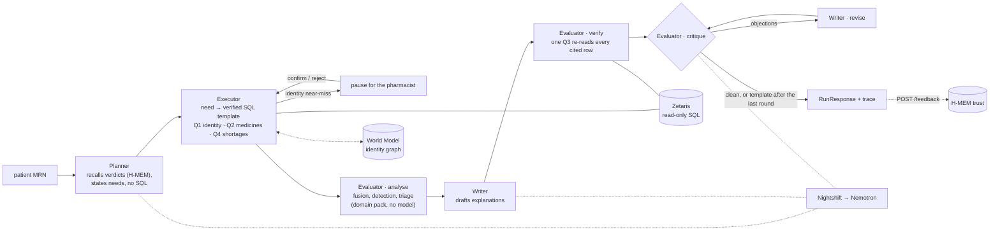

# MedTrace

**Medication reconciliation across systems that don't talk to each other.**
Open Agent Hackathon 2026 · Track 1 · Team Hakken (Anshuman, Arpon, Arnav)

> **100% synthetic patient data. Not medical advice.** MedTrace drafts a reconciliation for a
> pharmacist to review; it never changes a chart.

## The problem

When a patient is admitted to hospital, a pharmacist has to establish what they were
actually taking beforehand and check it against what has been charted. The answer is
scattered across four systems: the hospital EMR, the GP's list, the community pharmacy's
dispensing history and what the patient says at the bedside. Each is partial, each can be
out of date, and each describes the same medicine differently.

The Australian Commission on Safety and Quality in Health Care puts it plainly: "Between
10% and 67% of medication histories have at least one error, and up to 33% of these errors
have the potential to cause patient harm." Medication-related problems cause about 250,000
hospital admissions in Australia each year, at a cost of $1.4 billion, and about half of
that harm is preventable (Pharmaceutical Society of Australia, *Medicine Safety: Take
Care*, 2019). Sources and the exact wording we use are in
[`docs/PITCH_CLAIMS.md`](docs/PITCH_CLAIMS.md).

MedTrace produces a draft for the Best Possible Medication History: a pre-populated
medication history for a clinician to verify.

## What MedTrace does

- **Queries every source through Zetaris**, live, by SQL. The agents never read a file.
- **Links the patient's records across systems**, and **pauses for the pharmacist** when
  an identity match is close but not certain. Nothing from that record is used until they
  decide, and the decision is remembered.
- **Reconciles every medicine line.** Each source codes medicines its own way, and MedTrace
  resolves them all against a real PBS reference. A missing source is shown as *unknown*,
  never as "not taking".
- **Finds the discrepancies:** omissions, chart dose or frequency errors, duplications
  across combination products, stopped medicines still listed, and doses that cannot be
  confirmed from the records.
- **Ranks high-risk medicines first** (the ACSQHC APINCHS classes: insulins,
  anticoagulants, opioids and others).
- **Verifies before it shows anything.** One query re-reads every row a finding cites, and
  every sentence the model writes is checked against those rows.
- **Learns from the pharmacist.** Mark a source's value as out of date, and MedTrace trusts
  that source less on the next patient.

## Try it

**Quickest, no services needed (Docker):**

```bash
SAMPLE_MODE=true docker compose up --build
```

Open **http://localhost:8000** and pick a patient. `MRN0000015` shows the identity review
and high-risk dose checks. `MRN0000089` shows discrepancies with every source side by side.
`MRN0000003`, then `MRN0000007`, show the learning step. Or call the API directly:

```bash
curl -X POST 'localhost:8000/run?wait=true' -H 'content-type: application/json' \
     -d @input_examples/example_2.json
```

**Without Docker:**

```bash
make setup                                                    # .venv, pinned dependencies
SAMPLE_MODE=true .venv/bin/python run.py --input input_examples/example_2.json
SAMPLE_MODE=true .venv/bin/python run.py --input input_examples/example_1.json --confirm patient:INT00015
```

`SAMPLE_MODE=true` runs the real agent logic against recorded Zetaris results, with every
model step done by a deterministic offline function labelled `offline-heuristic`. There is
no Zetaris, no Nightshift and no network, and saved model text is never replayed. Thirteen
patients have a recorded run, covering every input in `input_examples/`.

**Live, against Zetaris and Nightshift:** see [Setup](#setup-zetaris-and-nightshift),
then:

```bash
cp .env.example .env                           # fill it in yourself
make lexicon && make synth                     # the reference tables and the synthetic silos
docker compose up --build -d                   # the app on :8000 and the silo service on :8100
.venv/bin/python scripts/register_sources.py --apply         # register the sources in Zetaris (once)
.venv/bin/python scripts/register_sources.py --usl --apply   # optional: the Unified Semantic Layer
```

Each `register_sources.py` command prints its statements as a dry run without `--apply`.

A live run takes from 30 seconds to about 9 minutes, almost all of it Nemotron's
reasoning, and every model request is bounded by the run's 10-minute deadline.

**Check the submission:** `make validate` reproduces the hackathon's disqualification
checklist from a fresh clone, with no `.env` and no network. It covers secrets, engine
conformance, `run.py` and `POST /run` in `SAMPLE_MODE`, the output examples, the full test
suite and the Docker build.

### API

`POST /run` (add `?wait=true` to run synchronously), `GET /run/{id}`, `GET /run/{id}/trace`,
`POST /run/{id}/identity`, `POST /feedback`, `GET /patients`, `GET /status`. The API has no
authentication, so it binds to `127.0.0.1` only.

## How it works

Four agents hand off to each other over a deterministic clinical domain pack. The full
diagram, with every step and boundary, is in [`docs/ARCHITECTURE.md`](docs/ARCHITECTURE.md).



| Agent | Role | Model route (intent) | Hands off to |
|---|---|---|---|
| **Planner** | Recalls past pharmacist verdicts from H-MEM, chooses which tools the run needs, and states each need in plain words. Never writes SQL. | `meterless/fast` | Executor, with a plan |
| **Executor** | Turns each need into a verified SQL template and runs it through the read-only Zetaris adapter. Writes linked patient records to the World Model and reads the linked set back. Uses the model only to pick a free-text line's meaning from a closed list. | `meterless/fast` | Evaluator, with source rows and normalised medicines |
| **Evaluator** | Runs the clinical domain pack (fusion, detection, triage, safety gate), re-reads every cited row in one query, and critiques the Writer's text against those rows: code rules plus a Nemotron faithfulness verdict. | `meterless/deep` | Writer, with findings, then objections to revise |
| **Writer** | Explains each finding in plain language from its own rows, and revises against the objections. Anything still disputed after the last round becomes the grounded template. | `meterless/deep` | The response |

Clinical decisions (identity linkage, fusion, detection, triage) are deterministic code in
`app/domain/packs/medtrace/`. The model plans, resolves free text, explains, and checks the
explanation; it never writes SQL and never decides a finding. Every handoff, critique round
and model call is visible step by step in the JSONL trace (`GET /run/{id}/trace`).

## Sponsor technology

Full detail: [`docs/SPONSOR_TECH.md`](docs/SPONSOR_TECH.md).

### Zetaris: the data layer

- Six sources are registered in Zetaris: four synthetic silos (EMR, GP, pharmacy, patient
  interview), the PBS medicines lexicon and the APINCHS high-risk classes. They're served
  as Lightning REST tables, flattened by SchemaStore views and unioned into one view
  (`scripts/register_sources.py`).
- The agents send Lightning SQL to the Zetaris REST API through a read-only adapter
  (`SELECT`/`SHOW`/`DESCRIBE`/`WITH` only, an enforced `LIMIT`, at most 8 queries per run).
  The SQL comes from templates verified live against committed fixtures, never from the
  model.
- **Unified Semantic Layer:** `medtrace_usl` turns 6 sources into 1 view of every medicine
  line, resolved to a medicine and its high-risk class. Its native data-quality rule caught
  14 charted strengths that no product is made in, every one a real dose error.
  **The Zetaris Scoring Methodology evidence (1a–2c) is indexed in
  [`docs/zetaris_usl/README.md`](docs/zetaris_usl/README.md).**

### Meterless: engines and runtime

- **World Model** (`app/engines/world_model/`, **8/8 official conformance checks**):
  - powers identity linkage;
  - records each linked patient record with its Zetaris provenance;
  - decides whose medicines to fetch from its graph;
  - remembers a pharmacist's identity decision, so the next run doesn't ask again.
- **H-MEM** (`app/engines/hmem/`, **13/13 official conformance vectors**):
  - holds the trust in each source that fusion uses;
  - a pharmacist's verdict is H-MEM feedback with a ledger entry, and persists across
    restarts;
  - the Planner recalls past verdicts before it plans (`memory_used`);
  - findings cite the trust records behind them.
- **Nightshift Runtime** is the only model provider. Every agent call goes through it, and
  each call records which model actually answered, from Nightshift's compute receipt.

Both engines are Python ports of the Meterless reference implementations, verified by those
engines' own conformance suites (`make conformance`).

### NVIDIA: Nemotron through Nightshift

In every recorded live run (`output_examples/live/`), every model call was answered by
`nvidia/nemotron-3.5-lightning-30b-a3b`, as recorded per call in `model_calls` and the
trace. The NVIDIA API key lives only in Nightshift → Setup → Providers; it is not in this
repository, in `.env` or in any log.

## Evidence

- **Detector scorecard** (`scripts/eval.py`) scores the real detection chain against a
  planted answer key. On held-out patients, with a simulated pharmacist review:
  - precision 0.95, recall 0.95, F1 0.95;
  - core APINCHS high-risk recall 30/32 (95% CI 0.80–0.98);
  - 0 false identity merges across 200 patients.

  Pinned by tests. `docs/DECISIONS.md` explains why 0.95, measured before one fix, is the
  figure we quote.
- **Output examples** (`output_examples/`): real runs of all five inputs, each with its
  JSONL trace. All five live runs completed successfully, answered by Nemotron through
  Nightshift, and their findings match the `SAMPLE_MODE` runs exactly. Regenerate with
  `make examples`.
- **Five sample inputs** (`input_examples/`), each with its expected outcome written down,
  including a staged learning pair (P0003 teaches, P0007 shows what was learned).
- **More than 860 unit tests**, plus `make validate` (above).

## Data

All patient data is synthetic: 200 seeded patients across four silos, with planted
discrepancies and identity traps and a ground-truth answer key, generated by
`scripts/generate_synthetic.py` (`make synth` reproduces the committed data exactly, and CI
checks it). The medicine reference data is real and public: PBS items, WHO ATC codes and
the ACSQHC APINCHS classes. The optional shortage overlay uses the TGA Medicine Shortage
Reports database. Origins, licences and how to regenerate are in
[`docs/DATA_SOURCES.md`](docs/DATA_SOURCES.md) and
[`docs/DATA_LICENCES.md`](docs/DATA_LICENCES.md); the data model is in
[`docs/DATA_SPEC.md`](docs/DATA_SPEC.md).

## Setup: Zetaris and Nightshift

Both run **on the host**, not in our compose file.

- **Zetaris:** install per the Participant Setup Guide (`zetaris-platform`). The web UI is
  `http://localhost:3000` and the REST API `http://localhost:8888/api/v1.0`, with org ID `1`
  on a local install. Create an API key in **Management → API Tokens** and put it in `.env`
  as `ZETARIS_API_KEY`.
- **Nightshift:** copy the Runtime URL and token from **Nightshift → Console** into
  `METERLESS_BASE_URL` and `METERLESS_RUNTIME_TOKEN`.
- **NVIDIA:** the API key goes **only** in Nightshift → Setup → Providers.

`make preflight` checks, read-only, what is reachable and what is missing. Inside the
containers both services are reached at `host.docker.internal`; `docker-compose.yml` sets
this.

## Responsible use

- **A pharmacist decides; MedTrace drafts.** It never changes a chart, and the UI shows the
  "synthetic data, not medical advice" disclaimer on every screen.
- **Identity is never guessed.** A near-miss match stops for a human before any of that
  record is read.
- **Missing is not the same as stopped.** A source with no record is shown as *unknown*,
  never as "not taking".
- **High-risk first.** APINCHS medicines are ranked first, and a dose that can't be
  confirmed (warfarin, insulin, prednisolone, methotrexate) becomes a task to confirm with
  the patient, not a guess.
- **Every finding is cited.** It must name the source rows it rests on, or the safety gate
  blocks it.
- **Model text is checked before it is shown,** the patient summary included: cited rows,
  numbers, no "not taking" where a source is unknown, and no instruction to stop, start or
  change a medicine. Text that fails is replaced with a grounded template.

## Limitations

- **Built for a hackathon, not yet for a ward.** It has run only on synthetic patients,
  and the UI has not been tested with pharmacists.
- **The scores show the logic does what it was designed to do,** on synthetic patients
  with a simulated pharmacist review, not how it would perform on real records. 32 core
  high-risk cases cannot support a "100% recall" claim, and we don't make one.
- **We can't choose which Nemotron answers.** Nightshift's router picks the lane, so the
  per-agent routes are a declared intent; the trace records what actually answered. The
  compute receipt we read that from is a build-specific response shape, and the adapter
  degrades gracefully without it.
- **Live runs are slow,** from 30 seconds to about 9 minutes, because of the model's
  reasoning. When the run's time is nearly spent, a step falls back to its grounded
  template and the run returns `partial` with what it has already verified.
- **The shortage overlay is optional.** It needs the TGA table registered in Zetaris, which
  requires a manual TGA download (`docs/DATA_LICENCES.md` §4). Without it the step is
  skipped, and the trace says so.

## AI tools and open-source code

- **AI coding tools:** built with **Claude Code**. Every session is logged in
  [`docs/AI_TOOLS_USAGE.md`](docs/AI_TOOLS_USAGE.md), and `CLAUDE.md` holds the working
  rules. Cursor was not used; the log explains why.
- **Open-source code adapted:** the World Model and H-MEM reference implementations and
  conformance runners from the Meterless repository (Apache-2.0, commit `1742dec`), ported
  to Python. Every ported file carries an Apache-2.0 attribution header, and the official
  H-MEM `vectors.json` is copied verbatim (`tests/engines/vectors/NOTICE.md`). The Zetaris
  REST call shape follows the Zetaris getting-started reference client.

## Pre-existing components

No pre-existing code of our own. Declared in [`docs/PREEXISTING.md`](docs/PREEXISTING.md):
- the Meterless engine specifications and conformance vectors (Apache-2.0);
- the Zetaris getting-started reference repository;
- the sponsor's `zetaris-platform` install, and the `NY_TAXI` and `TPCDS_DB` sample
  databases that shipped with it. Those predate the build window and are not used.

## Licence

MIT — see [`LICENSE`](LICENSE).
