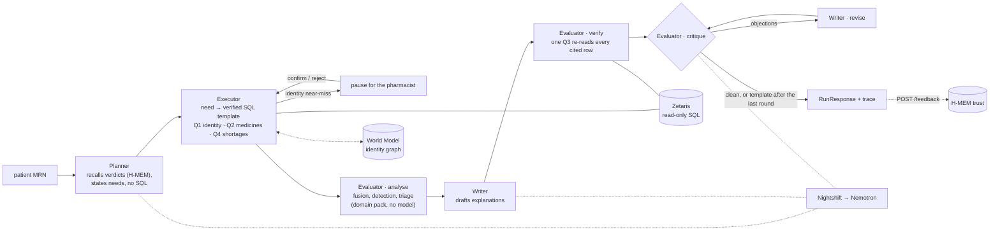

# MedTrace — Hakken Agent

> **Work in progress: Open Agent Hackathon 2026, team Hakken. Track 1.**
>
> **The data pipeline, the clinical logic, the agent loop, both Meterless engines and
> the API are built and run end to end, live and in `SAMPLE_MODE`. The Docker run path
> is not verified yet, and the UI has not yet been pointed at the live API.** Everything
> below says which is which.

Team Hakken (Anshuman, Arpon, Arnav).

**100% synthetic data. Not medical advice.** No real patient record is used anywhere.

## One-line pitch

MedTrace reconciles an admitted patient's pre-admission medicines across four
systems that don't talk to each other: the hospital EMR, the GP, the community
pharmacy and the bedside interview. It queries every source through Zetaris, says
"unknown" rather than "not taking" when a source is missing, ranks discrepancies so
high-risk ones reach the pharmacist first, and learns from the pharmacist which
source to trust.

## What actually works today

| Piece | State |
|---|---|
| **Synthetic data** (`scripts/generate_synthetic.py`, `make synth`) | **works.** 200 seeded patients across four silos, ~13,900 rows, with planted discrepancies and identity traps, and a ground-truth answer key. Real Australian medicine reference data (PBS, ATC, APINCHS). See `docs/DATA_SPEC.md`. |
| **Zetaris data layer** (`scripts/register_sources.py`) | **works on Arpon's and Arnav's machines.** Four silos registered as REST tables, a harmonised `medtrace.all_sources` view, and every query template verified live against committed fixtures. Each query takes about 2–6 s at 200 patients. |
| **Adapters** (`app/adapters/`) | **work.** Zetaris: the REST call shape, a read-only guard, a budget of 8 queries per run, and replay of recorded results. Nightshift: the Power contract, the answering model recorded from the receipt, truncation detected by token count. |
| **Agent loop** (`app/orchestrator.py`, `app/agents/`) | **works, live and in `SAMPLE_MODE`.** Planner → Executor → Evaluator → Writer over the domain pack. Identity near-misses pause for a human. One query re-verifies every cited row, and a critique → revise loop runs before anything is shown. Live on Arnav's machine (25–26 Oct), every model call was answered by `nvidia/nemotron-3.5-lightning-30b-a3b` through Nightshift. |
| **World Model and H-MEM** (`app/engines/`) | **work: 8/8 and 13/13 official conformance checks** (`make conformance`). Identity memory and pharmacist-taught trust run on them in the product. See [Engines used](#engines-used). |
| **Output examples** (`output_examples/`) | **real runs of all five inputs**, in `SAMPLE_MODE` and live, each with its JSONL trace (`make examples`). |
| **API and `run.py`** (`app/main.py`) | **work.** `POST /run`, `GET /run/{id}`, `GET /run/{id}/trace`, `POST /run/{id}/identity`, `GET /status`, `GET /patients`, `POST /feedback`. `python3 run.py --input input_examples/example_2.json` prints the run. |
| **`SAMPLE_MODE`** | **works.** Recorded Zetaris results, with every model step done by a deterministic offline function labelled `offline-heuristic`. No Zetaris, no Nightshift, no network. All five `input_examples/` produce the outcomes written in `input_examples/README.md`, pinned end to end by `tests/unit/test_orchestrator.py`. |
| **Clinical domain pack** (`app/domain/packs/medtrace/`) | **works.** Identity linkage, normalisation, coverage, trust-weighted fusion, discrepancy detection, the safety gate and triage. Real code, no model calls. |
| **Detector scorecard** (`scripts/eval.py`) | **works.** Scores the real chain against the answer key. Held-out, with simulated pharmacist review: **precision 0.95, recall 0.95, F1 0.95** (today's code prints recall 0.97 / F1 0.96, which includes one fix found while studying held-out misses; 0.95 is the clean figure, `docs/DECISIONS.md`); core APINCHS high-risk recall **30/32** (95% CI 0.80–0.98); **0 false merges** across 200 patients. Pinned by tests. |
| **Sample inputs** (`input_examples/`) | **five**, each with replay fixtures and a written expected outcome, including a staged learning-demo pair (see `docs/DECISIONS.md`). |
| `scripts/preflight.py`, `app/config.py`, `scripts/secret_scan.py` | **work.** Preflight, validated settings with secrets as `SecretStr`, and a pre-commit secret scan. |

### Not finished

- **The Docker run path.** The API exists now, but the image has not been built and
  run end to end.
- **The web UI** (`web/`) is built but has only run in mock mode, against hand-written
  example responses in `tests/fixtures/api/`. It has not yet been pointed at the API.
- **Speed.** A live run takes 30 s to 9 min (`output_examples/live/`), almost all of it
  Nemotron's hidden reasoning. That's inside the 10-minute limit. When time runs short, a
  model step is skipped and the run returns `partial` with what it has already verified.

Nothing here fakes a result: unbuilt pieces raise `NotImplementedError` or exit non-zero.

## Quickstart

```bash
make setup                      # .venv, pinned deps, pre-commit hook
cp .env.example .env            # then fill it in yourself
make preflight                  # read-only: what is reachable and what is missing
make test                       # passes; ~43 tests skip until you build the data below
```

Build the data (no network needed) and run the full suite, scorecard included:

```bash
make lexicon                    # reference tables; PBS codes stay synthetic without `make data`
make synth                      # 200 synthetic patients; uses the committed lexicon, so the
                                # committed fixtures come out byte-identical
make test                       # now nothing skips for missing data
.venv/bin/python scripts/eval.py --split heldout   # the scorecard
```

Run it:

```bash
SAMPLE_MODE=true .venv/bin/python run.py --input input_examples/example_2.json   # no services needed
SAMPLE_MODE=true .venv/bin/python run.py --input input_examples/example_1.json --confirm patient:INT00015
.venv/bin/python run.py serve        # the API on :8000, live against your Zetaris and Nightshift
```

Docker: **not verified yet.** The API now exists, but nobody has built and run the
image end to end. The intended commands:

```bash
docker compose up --build
curl -X POST localhost:8000/run -H 'content-type: application/json' \
     -d @input_examples/example_1.json
```

## Setup: Zetaris and Nightshift

Both run **on the host**, not in our compose file.

- **Zetaris** — install per the Participant Setup Guide (`zetaris-platform` compose).
  Web UI `http://localhost:3000`, REST API `http://localhost:8888/api/v1.0`, org ID `1`
  on a local install. Create an API key in **Management → API Tokens** (shown in
  plaintext once) and put it in `.env` as `ZETARIS_API_KEY`.
  **Never call port 8889** — it is internal.
- **Nightshift** — copy the Runtime URL and token from **Nightshift → Console** into
  `METERLESS_BASE_URL` and `METERLESS_RUNTIME_TOKEN`.
- **NVIDIA** — the NVIDIA API key goes **only** in Nightshift → Setup → Providers.
  It must never appear in this repo, in `.env`, in logs, or in any submission material.

Inside a container, use `host.docker.internal` instead of `localhost` (our
`docker-compose.yml` already overrides both URLs).

## Architecture

Drawn from `app/orchestrator.py`. The full version, with every step and boundary, is in
[`docs/ARCHITECTURE.md`](docs/ARCHITECTURE.md).



## Agents and roles

| Agent | Role | Model route (intent) | Hands off to |
|---|---|---|---|
| **Planner** | Recalls past pharmacist verdicts from H-MEM, chooses which tools the run needs, and states each need in plain words. Never writes SQL. | `meterless/fast` | Executor, with a `Plan` |
| **Executor** | Turns each need into a verified SQL template and runs it through the read-only Zetaris adapter. Writes linked patient records to the World Model and reads the linked set back from it. Uses the model only to pick a free-text line's meaning from a closed list. | `meterless/fast` | Evaluator, with source rows and normalised medicines |
| **Evaluator** | Runs the clinical domain pack (fusion, detection, triage, safety gate), re-reads every cited row in one query, and critiques the Writer's text against those rows: code rules plus a Nemotron faithfulness verdict. | `meterless/deep` | Writer, with findings, then with objections to revise |
| **Writer** | Explains each finding in plain language from its own rows, and revises against the objections. Anything still disputed after the last round becomes the grounded template. | `meterless/deep` | The response |

Handoffs, the critique → revise loop (capped by `MAX_AGENT_ITERATIONS`, default 2) and
every model call are visible step by step in the JSONL trace. Routes are a declared
intent: Nightshift picks the lane, and `model_calls[].routed_model` records which
Nemotron actually answered (see [AI and model usage](#ai-and-model-usage)).

## Data sources

Synthetic patients only, in four silos (hospital EMR, GP, pharmacy, patient
interview), generated by `scripts/generate_synthetic.py` with a fixed seed. The
medicine reference data is real and public: PBS items, WHO ATC codes and the ACSQHC
APINCHS high-risk classes. Origin, licence and how to regenerate are in
`docs/DATA_SOURCES.md` and `docs/DATA_LICENCES.md`; the data model is in
`docs/DATA_SPEC.md`. The sponsor's pre-existing `NY_TAXI` and `TPCDS_DB` databases
are not used.

## Sample mode

`SAMPLE_MODE=true` runs the real agent logic against recorded Zetaris results
(`tests/fixtures/medtrace/`, diffed identical to live), with no Zetaris, no Nightshift
and no network. Every model step is done by a deterministic offline function labelled
`offline-heuristic` in the trace and in `model_calls`. The Writer's offline
explanations are built only from each finding's own rows. It does real work on the
cached data, linkage, fusion, detection and verification included, and does **not**
replay saved model text.

## Engines used

**World Model: implemented, 8/8 official conformance checks green** (`make conformance`).
`app/engines/world_model/` is a Python port of the Meterless reference implementation:
- stable IDs (NFKD + sha-256)
- banded merge decisions at 0.85 / 0.82, per the conformance runner and against the
  prose spec (`docs/DECISIONS.md`)
- an event-sourced store with mandatory provenance, non-destructive aliases,
  bitemporal edges and a strictly ordered audit log
- the idempotent ingest pipeline

**Where it works in the product:**
- **Identity linkage.** `identity.decide` delegates to the engine.
- **Patient records.** Every linked patient record is written as `patient:<source>:<id>`
  with its Zetaris provenance, and the Executor reads whose medicines to fetch from
  the World Model graph.
- **Remembered identity decisions.** A pharmacist's decision on a near-miss is recorded,
  so the next run for that patient doesn't ask again. The trace shows the decision
  and its audit `seq`.

**H-MEM: implemented, 13/13 official conformance vectors green** (`make conformance`).
`app/engines/hmem/` is a Python port of the Meterless reference:
- the deterministic embedder
- a store that rejects records without a source
- the append-only ledger with 17 actions
- the exact hybrid retrieval formula (spec default threshold 0.35, top 5; the Planner's
  recall uses 0.15, because absolute scores depend on the embedder. The reasoning is in
  `app/agents/memory.py`, and every `retrieval_reason` states the threshold.)
- feedback deltas +0.05 / −0.03 / −0.20, clamped, with a `review` tag on `wrong`
- conflicts with the 0.70 auto-resolve gate
- preview-first sleep with guardrails
- dreaming behind an approval gate

**Where it works in the product:**
- **The trust the pharmacist teaches lives in H-MEM.** Each `(source, attribute)` prior
  is a long-term H-MEM record, and fusion reads trust from it. A verdict is H-MEM
  feedback on that record, with a ledger entry, and it **persists across restarts**:
  the learning demo (reject P0003's GP dose, and P0007 resolves differently) survives
  one.
- **The verdict itself is remembered**, and the Planner recalls such memories before it
  plans. They're returned in `RunResponse.memory_used`.
- **Findings cite their trust records** (`hmem_record_ids`).

## AI and model usage

- **Models** reach us only through the **Meterless Nightshift Runtime**
  (OpenAI-compatible, default `http://127.0.0.1:8088/v1`). Observed `online` on Arpon's
  machine on 23 Oct 2026, where a request on `meterless/auto` was answered by
  `nvidia/nemotron-3.5-super-vl-120b-a12b`. Each teammate runs their own runtime.
- **Which model answered** is recorded per request from the `meterless` compute receipt
  in the response body (`routed_model` / `winning_route`), not from the route we asked
  for. It goes into `RunResponse.model_calls` and the JSONL trace in `logs/`. **Lane
  pinning was not honoured** on Arpon's runtime (build `m1-m4`): every request
  raced six lanes under a learned router, so role→disposition routing can only ever be
  a declared intent, and the trace will record what actually ran. Lane configuration is
  per-machine. See `docs/DECISIONS.md`.
- **AI coding tools used:** **Claude Code**, logged per session in
  `docs/AI_TOOLS_USAGE.md`. `CLAUDE.md` holds the working rules. Cursor is not used —
  see that log for why.
- **Open-source code materially adapted:** the **World Model and H-MEM reference
  implementations and conformance runners** from the Meterless repo (Apache-2.0,
  commit `1742dec`), ported to Python. Every ported file carries an Apache-2.0
  attribution header, and the official H-MEM `vectors.json` is copied verbatim
  (`tests/engines/vectors/NOTICE.md`). The Zetaris REST call shape in our adapter
  follows that project's reference client. Real Zetaris and Nightshift responses are recorded as test fixtures.
- **Data:** synthetic only, seeded and deterministic: `make lexicon && make synth`
  reproduces the committed data exactly, and CI checks that on every push. Real PBS
  codes come from the committed lexicon; rebuilding them needs `make data` (a
  rate-limited PBS API fetch) plus a manual download of the data.gov.au PBS Item
  Report (`docs/DATA_LICENCES.md` §5). The Zetaris instance carries the sponsor's own
  pre-existing sample databases, declared in `docs/PREEXISTING.md` and unused.

## Responsible use

Synthetic data only; no real personal, clinical or financial records. **Not medical
advice:** MedTrace drafts a reconciliation for a pharmacist to review and never
changes a chart itself. Built in the domain pack: an identity near-miss stops for a
human before any of that record is read; a missing source is shown as *unknown*,
never as "not taking"; high-risk (APINCHS) medicines are ranked first; a dose that
can't be confirmed (warfarin, insulin, prednisolone, methotrexate) becomes a task to
confirm with the patient, not a guess; and every finding must cite the source rows
it rests on, or the safety gate blocks it. The UI shows the disclaimer on every screen.

## Limitations

- **The product is not finished.** The data layer, clinical logic, agent loop, engines
  and API work. Docker is unverified, and the UI has only run against example responses.
- Scores come from synthetic patients and a simulated pharmacist review. They show the
  logic does what it was designed to do, not how it performs on real records. 32 core
  high-risk cases cannot support a "100% recall" claim, and we don't make one.
- Both services have been verified live on **two machines** (Arpon's, 23–24 Oct, and
  Arnav's, 25 Oct), not more. See `docs/ENVIRONMENTS.md` for who can run what.
- We cannot choose *which* Nemotron answers a request (see above).
- The Nightshift compute receipt we rely on for evidence is an undocumented,
  build-specific response shape; the adapter must degrade gracefully without it.

## Pre-existing components

No pre-existing code of our own. Declared in `docs/PREEXISTING.md`: the Meterless engine
specifications and conformance vectors (Apache-2.0), the Zetaris getting-started
reference repo, the sponsor's `zetaris-platform` install, and the `NY_TAXI` (15 tables)
and `TPCDS_DB` (308 tables) sample databases that shipped with that install. The sample
databases are declared because they predate the build window; they are not used.

## Licence

MIT — see `LICENSE`.
