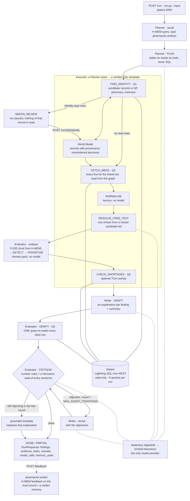

# Architecture

Drawn from `app/orchestrator.py` as it runs today. Step names are the `step` field
every trace event carries (`logs/trace-<run_id>.jsonl`, and `GET /run/{id}/trace`).

## One run

Solid links are the run's order. Dotted links to Nightshift mark the five model steps.
Every other step is deterministic code.

## Agents and handoffs

| Agent | Does | Model route (declared intent) | Hands off |
|---|---|---|---|
| **Planner** (`app/agents/planner.py`) | Recalls past verdicts from H-MEM, then picks which tools the run needs and states each need in plain words. It sees the view catalogue and the query budget. It never writes SQL. | `meterless/fast` | A `Plan` (tools + needs) → Executor |
| **Executor** (`app/agents/executor.py`) | Maps each need to a verified SQL template (Q1 identity, Q2 medicines, Q4 shortages). The Zetaris adapter checks the SQL is read-only and sends it. Normalises with the lexicon, and asks the model only to choose a free-text line's meaning from a closed candidate list. Writes linked records to the World Model. | `meterless/fast` (free text only) | Source rows + normalised statements → Evaluator |
| **Evaluator** (`app/agents/evaluator.py`) | Runs the domain pack: coverage, trust-weighted fusion, detection, triage, safety gate. Then it re-reads every cited row in one Q3 query, and critiques the Writer's text against those rows: number rules in code, plus a Nemotron faithfulness verdict per finding. | `meterless/deep` | Findings → Writer; objections → Writer (revise) |
| **Writer** (`app/agents/writer.py`) | Drafts a plain-language explanation per finding and a summary from each finding's own rows, and revises against the Evaluator's objections. | `meterless/deep` | Explanations → Evaluator (critique) → response |

**Model routes are intent, not control.** Nightshift Runtime build `m1-m4` races six lanes
under a learned router and does not honour a pinned lane. The model that actually
answered is recorded per call from the Nightshift receipt (`model_calls[].routed_model`).
Live on 25–26 Oct, every call was answered by `nvidia/nemotron-3.5-lightning-30b-a3b`.
See `docs/DECISIONS.md`.

## Engines

- **World Model** (`app/engines/world_model/`, 8/8 conformance): identity linkage
  (`identity.decide` delegates to it). Each linked record is stored as
  `patient:<source>:<id>` with its Zetaris query as provenance. The medicine fetch reads
  the linked set from the graph. A pharmacist's identity decision is a `same-person-as` or
  `distinct-from` edge, so the next run for that patient doesn't ask again.
- **H-MEM** (`app/engines/hmem/`, 13/13 conformance): each `(source, attribute)` trust
  prior is a long-term record that fusion reads. A verdict is `HMEM.feedback()` with a
  ledger entry, plus a verdict memory the Planner recalls next run. Findings cite their
  trust records (`hmem_record_ids`).

Both persist under `STATE_DIR` in live mode. `SAMPLE_MODE` keeps them in memory.

## Boundaries that matter

- **Agents never read data files.** Facts come from Zetaris over REST, or not at all.
  The adapter rejects anything but `SELECT`/`SHOW`/`DESCRIBE`/`WITH` and enforces a `LIMIT`.
- **No model-written SQL.** The Planner states needs, and the Executor fills templates
  that were verified live against committed fixtures.
- **Every model call goes through Nightshift.** There is no second provider. In
  `SAMPLE_MODE`, each model step is a deterministic offline function labelled
  `offline-heuristic`. Saved model text is never replayed.
- **Clinical decisions are code, not prompts.** Linkage, fusion, detection and triage
  live in `app/domain/packs/medtrace/` and are scored by `scripts/eval.py`. The model
  plans, resolves free text, explains, and checks the explanation.
- **Bounded.** Critique rounds are capped by `MAX_AGENT_ITERATIONS` (default 2). The run
  is capped by `RUN_TIMEOUT_S` (600) and by 8 Zetaris queries. A model step is skipped
  when too little time is left for it. Hitting any limit returns `status: "partial"`
  with whatever was already found and verified. A Nightshift failure degrades that one
  step to its template and says so in `caveats`.
