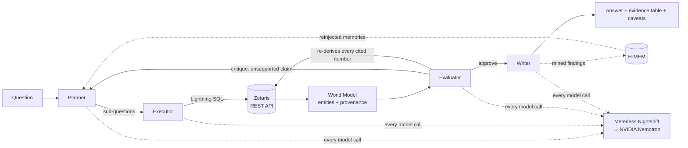

# Architecture

**Phase 1: skeleton only.** The mermaid diagram lands with the agent loop in Phase 4,
drawn from the code that actually exists rather than from the plan.

Intended shape, for orientation:

Boundaries that matter:

- Agents never read data files. Facts come from Zetaris over REST, or not at all.
- Every model call goes through Nightshift. There is no second provider.
- The Evaluator independently re-queries Zetaris to verify each number the Writer
  cites, and blocks unsupported claims.
- Both loops are bounded: `MAX_AGENT_ITERATIONS` per critique cycle, `RUN_TIMEOUT_S`
  for the whole run, which returns `status: "partial"` rather than hanging.
