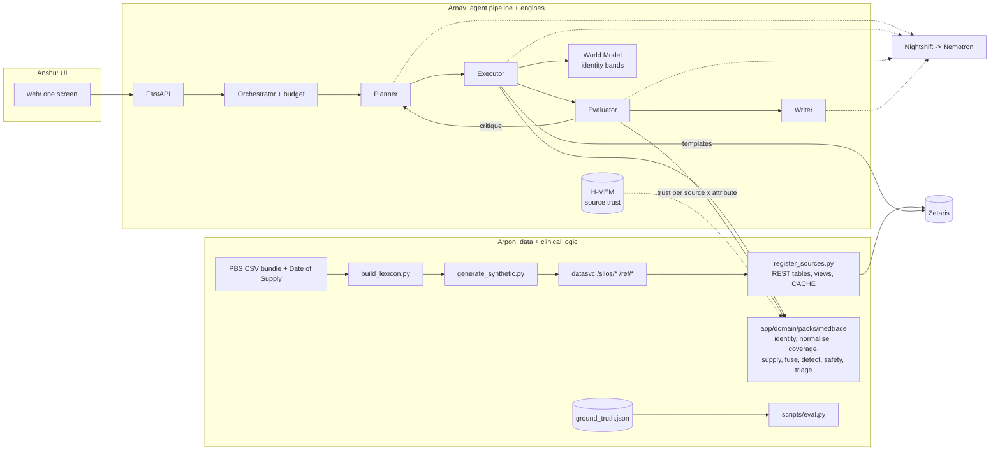

# MedTrace: roles and build plan, Saturday 24 Oct 2026 (v2)

Commit as `docs/PLAN_2026-10-24.md`. Everyone, and everyone's Claude Code, reads this before starting today.
It supersedes "Roles: TBD" in `docs/TEAM.md` and `docs/ONBOARDING.md`.

v3: Anshu is on the UI full time from today, so the engine ports move to Arnav (section 5, items 8 and 9). Anshu's UI work is section 6.

v2 folded in two research outputs. Keep both as source material in the repo:
- `docs/research/DATA_SOURCES.md`, the open Australian reference data plan.
- `docs/research/FRAGMENTATION_BRIEF.md`, failure modes and detection methods.

Deadline: **Wed 28 Oct, 10:45am AEDT. Submit by 9am.**

---

## 0. The big picture

**What we are building.** A pharmacist picks an admitted patient. MedTrace does six things:
1. Finds that patient across 4 separate systems through Zetaris: hospital EMR, GP, community pharmacy and patient report.
2. Links the records, sending near-misses to a human.
3. Says honestly which sources it found and which it could not.
4. Builds a cited draft Best Possible Medication History (BPMH).
5. Flags discrepancies, with high-risk (APINCHS) medicines first.
6. Learns from the pharmacist's verdicts which source to trust for which attribute.

Every model call goes through Nightshift to an NVIDIA Nemotron. Positioning: **a draft BPMH for pharmacist confirmation**, consistent with ACSQHC Standard 4 (Actions 4.5 and 4.6, at least two sources).

**The split:**
- **Arpon: data and clinical truth.**
  - Reference data, built from PBS.
  - The synthetic silos with labelled corruptions.
  - Zetaris registration.
  - Every deterministic clinical function: identity scoring, normalisation, coverage, supply arithmetic, fusion, detection, safety, triage.
  - The eval harness.
- **Arnav: the agent pipeline.**
  - Adapters, orchestrator and the four agents.
  - Human-in-the-loop steps, the API and the trace.
  - He calls Arpon's functions and never reimplements clinical logic.
  - **Also the H-MEM and World Model engine ports**, run in a second, parallel Claude Code session (his Max plan has the capacity).
- **Anshu: the UI.**
  - The one-screen pharmacist UI in `web/`, starting today.
  - Built against example `RunResponse` JSON, then pointed at the real API.
  - Needs no Zetaris and no Nightshift.

**The one constraint that shapes everything is Zetaris latency** (`docs/DECISIONS.md`, 24 Oct).
- About 4 s per trivial query warm, and 91 s for a 2-table JOIN.
- This is per-query overhead, so smaller data does not fix it.
  > **Corrected 24 Oct (Arpon), see `docs/DECISIONS.md`:** the second bullet is wrong.
  > Latency tracks **bytes scanned** (~1 s + 2–3 s/MB), and the 91 s join scanned 11 MB
  > of geometry in a sample table. Smaller data *does* fix it: at ~1 MB per silo a
  > query is 1–3 s and a whole run costs ~10 s of Zetaris. **The five rules below still
  > stand** — they are prudent rather than forced, and "no JOINs at agent time" is now
  > required for a different reason: a union-of-explode view cannot be referenced twice
  > in one query at all.

The rules that follow:
- **3 to 4 Zetaris queries per patient run**, with a hard budget of 8.
- **No JOINs at agent time.** Harmonise in cached `SCHEMASTORE VIEW`s at registration.
- **Reference data is read from Zetaris once at app startup** and cached in-process, never per run.
- **Verification is one batched query**, never one per claim.
- **Agents pick from vetted SQL templates.** Free SQL is a budgeted fallback.



---

## 1. Ownership

| Area | Owner | Files |
|---|---|---|
| Reference data fetch and build (PBS, Date of Supply, APINCHS, nicknames, TGA) | Arpon | `scripts/fetch_reference.py`, `scripts/build_lexicon.py`, `data/reference/` |
| Data spec, generator, ground truth, fixtures | Arpon | `docs/DATA_SPEC.md`, `scripts/generate_synthetic.py`, `data/synthetic/`, `tests/fixtures/medtrace/` |
| datasvc and Zetaris registration | Arpon | `datasvc/`, `scripts/register_sources.py` |
| Clinical logic and SQL templates | Arpon | `app/domain/packs/medtrace/*` |
| Evaluation | Arpon | `scripts/eval.py`, `tests/eval/` |
| Licences | Arpon | `docs/DATA_LICENCES.md`, data rows in `docs/PREEXISTING.md` |
| Zetaris and Nightshift adapters | Arnav | `app/adapters/*` |
| Orchestrator, agents, prompts, budget, API, trace | Arnav | `app/orchestrator.py`, `app/agents/*`, `app/prompts/*`, `app/api.py`, `app/trace.py` |
| `app/schemas.py` (shared) | Arnav edits, Arpon signs off clinical fields | |
| World Model port plus 8 conformance checks | Arnav (engines session, first) | `app/engines/world_model/` |
| H-MEM port plus 13 conformance checks | Arnav (engines session, second) | `app/engines/hmem/` |
| Example API responses for the UI | Arnav | `tests/fixtures/api/*.json` |
| UI | Anshu | `web/` |

**Shared files.** Change any of these only with a `docs/HANDOFF.md` note and a line in the PR:
- `app/schemas.py`, `app/config.py`, `.env.example`, `requirements.txt`
- `CLAUDE.md`, `.claude/`
- `docs/DATA_SPEC.md`
- `app/domain/packs/medtrace/types.py`

Arpon adds `jellyfish` to `requirements.txt` for Jaro-Winkler and metaphone.

---

## 2. The contracts (freeze by 12pm today)

### 2.1 Zetaris catalogue

Each patient source is its own Lightning database and REST table, served whole at one URL (`DECISIONS.md`, 23 Oct). All views live in container `medtrace`.

| Source | Lightning DB | REST table | datasvc URL | View |
|---|---|---|---|---|
| Hospital EMR (admission chart plus last discharge) | `MT_EMR` | `emr_raw` | `/silos/emr` | `medtrace.emr` |
| GP practice summary | `MT_GP` | `gp_raw` | `/silos/gp` | `medtrace.gp` |
| Community pharmacy dispensing | `MT_PHARMACY` | `pharmacy_raw` | `/silos/pharmacy` | `medtrace.pharmacy` |
| Patient or carer interview | `MT_PATIENT` | `patient_raw` | `/silos/patient` | `medtrace.patient_report` |
| **Reference:** medicines lexicon (PBS-derived) | `MT_REF` | `lexicon_raw` | `/ref/lexicon` | `medtrace.med_lexicon` |
| **Reference:** APINCHS by ATC prefix | `MT_REF` | `apinchs_raw` | `/ref/apinchs` | `medtrace.apinchs` |
| **Reference:** nickname table | `MT_REF` | `nicknames_raw` | `/ref/nicknames` | `medtrace.nicknames` |
| TGA shortages (Monday, optional) | `MT_TGA` | `tga_raw` | `/ref/tga` | `medtrace.tga_shortages` |

Plus `medtrace.all_sources`: a `UNION ALL` of the 4 patient views mapped to the harmonised columns in 2.3, cached. That is the federated query in the demo.

**Spike first.** Confirm the union view over explode views works, caches and supports `DISTINCT`.
- Reference it only once per query (`REFERENCE_NOTES` 1.2).
- If it fails, query the 4 views separately, in parallel if Zetaris accepts concurrent calls.

**Why the reference data goes through Zetaris and not a Python file.** The rule is "agents never read data files". Reference views are read at startup (Q_REF, 3 queries) and cached, so the facts come from Zetaris and no run pays the latency.

### 2.2 Native silo shapes (deliberately heterogeneous)

Each endpoint returns `{"records": [...]}`: flat rows, one per medication statement, with demographics repeated.

Absence rules:
- **Known to a source with no meds:** one row with the med fields null.
- **Absent from a source:** no rows.
- Every row has a unique `row_id` with a source prefix (`PHM-000123`).

Identifier rules:
- **Synthetic IHI** `ihi_syn` is formatted `SYN-` plus 12 digits. It is never the real 16-digit IHI format, and is deliberately missing at different rates per source.
- No Medicare numbers.
- No real identifiers of any kind.

**EMR** (`/silos/emr`)
- `row_id, mrn, ihi_syn (~95%), given_name, family_name, dob (YYYY-MM-DD), sex, postcode`
- `record_kind (admission_chart | prior_discharge), record_date`
- `med_name, amt_mp_code (null if free-typed), strength, dose, dose_unit, route, frequency (bd, tds, mane...)`
- `chart_note` (e.g. "withheld: contrast", which makes it documented intentional)
- `discharge_action (continue | cease | start | change; prior_discharge only), action_reason`

**GP** (`/silos/gp`)
- `row_id, gp_pid, ihi_syn (~80%), first_name (may be a nickname), surname, previous_surname, birth_date (DD/MM/YYYY), gender, postcode`
- `drug_text (brand or generic), amt_code (MPP, TPP or MP; may be null), strength, directions (free text, "1 tab bd")`
- `status (active | ceased), last_reviewed, list_last_updated` (document date, for the age banner)

**Pharmacy** (`/silos/pharmacy`)
- `row_id, cust_no, ihi_syn (~70%), name ("SMITH, Margaret"), dob, postcode, pharmacy_id`
- `dispensed_on, pbs_code (null if private), brand, strength, form, qty, days_supply, repeats_left, script_type (PBS | private), prescriber`

**Patient report** (`/silos/patient`)
- `row_id, intake_id, ihi_syn (~30%), name_given (free text), dob (may carry a typo or day/month swap)`
- `med_described` (free text: "Lipitor", "my blood thinner", "fish oil")
- `how_often (free text), still_taking (yes | no | unsure)`

### 2.3 Harmonised columns (`medtrace.all_sources`)

The view renames columns and does not parse. All parsing happens in Python, where it is tested. Every value arrives as a string; only `parse.py` casts.

| Column | EMR | GP | Pharmacy | Patient |
|---|---|---|---|---|
| `source` | `'emr'` | `'gp'` | `'pharmacy'` | `'patient'` |
| `row_id` | row_id | row_id | row_id | row_id |
| `source_patient_id` | mrn | gp_pid | cust_no | intake_id |
| `ihi_syn` | ihi_syn | ihi_syn | ihi_syn | ihi_syn |
| `name_given` | given_name | first_name | name (split later) | name_given |
| `name_family` | family_name | surname | null | null |
| `name_previous` | null | previous_surname | null | null |
| `dob_text` | dob | birth_date | dob | dob |
| `sex` | sex | gender | null | null |
| `postcode` | postcode | postcode | postcode | null |
| `record_kind` | record_kind | `'gp_list'` | `'dispense'` | `'interview'` |
| `doc_date` | record_date | list_last_updated | dispensed_on | null |
| `med_text` | med_name | drug_text | brand | med_described |
| `med_code` | amt_mp_code | amt_code | pbs_code | null |
| `code_system` | `'amt'` | `'amt'` | `'pbs'` | null |
| `strength_text` | strength | strength | strength | null |
| `dose_text` | dose + dose_unit | null | null | null |
| `route_text` | route | null | form | null |
| `freq_text` | frequency | directions | null | how_often |
| `status_text` | discharge_action | status | null | still_taking |
| `note_text` | chart_note + action_reason | null | null | null |
| `qty` | null | null | qty | null |
| `days_supply` | null | null | days_supply | null |
| `pharmacy_id` | null | null | pharmacy_id | null |
| `script_type` | null | null | script_type | null |

### 2.4 SQL templates and the query budget

These live in `app/domain/packs/medtrace/queries.py` (Arpon). Each function returns one Lightning SQL statement with no trailing semicolon and escaped values.

| ID | Function | Purpose | When |
|---|---|---|---|
| Q_REF | `q_reference(name)` | lexicon, APINCHS and nicknames | app startup, cached (3 queries) |
| Q0 | `q_admissions()` | patient picker list from `medtrace.emr` | UI load, cached |
| Q1 | `q_identity_candidates(anchor)` | blocking on `all_sources` (see below) | once per run |
| Q2 | `q_meds_for(links)` | all rows for the linked `(source, source_patient_id)` pairs | once, and again only after a human identity decision |
| Q3 | `q_verify_rows(row_ids)` | re-fetch every cited row | once per Evaluator pass |
| Q4 | `q_shortages(generics)` | TGA overlay | optional, Monday |

Q1 matches a row if any one of these holds. This is what catches the planted typos, swaps and maiden names:
- same `ihi_syn`
- same `dob_text` in any format
- DOB with day and month swapped
- same birth year plus surname prefix or previous surname

**Budget.** `MAX_ZETARIS_QUERIES_PER_RUN = 8`: Q1, Q2 (up to 2), Q3 (up to 2), Q4 and one free-SQL step.

**Expected run time.** About 4 queries at 5 to 10 s, plus about 6 model calls at 1 to 5 s. That comes to under 2 minutes, inside the 5 to 10 minute judging limit.

### 2.5 Python interfaces (Arpon implements, Arnav calls)

Everything lives in `app/domain/packs/medtrace/`, and every function is pure: no I/O and no model calls. **Arpon pushes the whole package as a skeleton at 12pm** (section 4, step 3b): `types.py` final, and every function with its real signature raising `NotImplementedError("Arpon: <file>")`. Arnav imports these from the start and never writes his own stubs, so real code replaces the skeleton with no merge conflicts. Where Arnav needs output before the real code lands, he monkeypatches in his own tests or wires a fixture-backed fallback in his code, never by editing Arpon's files.

```python
# types.py (shared)
class SourceRow(BaseModel): ...            # harmonised row from 2.3, cast; dob_raw kept
class Lexicon: ...                         # built from Q_REF rows, not from files
class IdentityLink(BaseModel):
    anchor_id: str; candidate_id: str      # "emr:MRN000123", "gp:GP004411"
    match_weight: float                    # Fellegi-Sunter log2 sum
    probability: float                     # posterior 0..1 (logistic of weight + prior)
    band: Literal["auto-merge", "review", "new"]   # world_model.decide(probability)
    tier: Literal["ihi_exact", "ihi_conflict", "probabilistic"]
    field_evidence: dict[str, str]         # {"given": "nickname Peggy~Margaret", "dob": "day/month swap"}
    guards: list[str]                      # "lookalike_cluster", "transitivity_suspect", "overlay_suspect"
class Coverage(BaseModel):
    source: str
    state: Literal["found", "near_miss_pending", "not_found"]
    scope_notes: list[str]                 # "pharmacy_id P2 only", "GP list updated 14 months ago"
class MedStatement(BaseModel):
    source: str; row_id: str; raw_text: str
    generic: str | None; ingredients: list[tuple[str, float | None]]   # combinations decomposed
    atc: str | None; release: Literal["IR", "MR", "unknown"]; route: str | None
    daily_dose_mg: float | None            # total daily dose in canonical units
    prn: bool; status: Literal["active", "ceased", "unknown"]
    doc_date: date | None
    resolution: Literal["code", "lexicon", "fuzzy", "llm", "unmapped"]
class EvidenceState(str, Enum): PRESENT = "present"; ABSENT_IN_SCOPE = "absent_in_scope"; UNKNOWN = "unknown"
class FusedMed(BaseModel):                 # one row of the BPMH grid
    generic: str
    per_source: dict[str, EvidenceState]
    attributes: dict[str, FusedValue]      # existence, daily_dose, frequency, release, route
    abstained: list[str]                   # attributes in CONFLICT, "ask patient"
class DiscrepancyCandidate(BaseModel):
    id: str; type: DiscrepancyType; generic: str
    sources_involved: list[str]; row_ids: list[str]; detail: dict
    high_risk_class: str | None; severity: Literal["high", "medium", "low"]
    intent_status: Literal["documented_intentional", "possibly_intentional", "likely_unintentional"]
    priority: float; tasks: list[str]      # "Confirm current warfarin dose with patient or INR book"
```

```python
# parse.py
def rows_from_sql(result: SqlResult) -> list[SourceRow]
def build_lexicon(lexicon_rows, apinchs_rows, nickname_rows) -> Lexicon

# identity.py  (brief section 1)
def score_pair(a: SourceRow, b: SourceRow, lex: Lexicon) -> IdentityLink
    # Tier 1: ihi_syn equal -> 1.0; ihi_syn conflict -> hard non-link.
    # Tier 2: Fellegi-Sunter. Jaro-Winkler plus nickname table on given names;
    #   surname vs previous_surname; DOB comparator giving partial credit for a
    #   day/month swap, a 1-digit edit, or year off by 1 or 10; postcode as weak evidence.
    #   m/u hand-set today, re-estimated from tune-split ground truth on Sunday.
def link_identity(anchor: SourceRow, candidates: list[SourceRow], lex: Lexicon) -> list[IdentityLink]
    # Lookalike guard: same name+DOB twice in one source -> raise threshold and
    #   require a distinguishing field.
    # Transitivity check: A~B, B~C but A!~C -> review.
def detect_overlay(rows_for_one_record: list[SourceRow]) -> list[str]
    # Two DOBs or sexes, or the same chronic drug at different pharmacies on the same day.
    # Stretch.

# normalise.py  (brief section 4)
def normalise_med(row: SourceRow, lex: Lexicon) -> MedStatement
    # Order: code -> exact lexicon (brand, generic, salt-stripped) -> Jaro-Winkler/trigram
    #   -> unmapped.
    # Decomposes combinations, computes total daily dose, parses BD/TDS/mane/nocte/weekly/PRN,
    #   handles mcg vs mg, sets release class.
def llm_candidates(text: str, lex: Lexicon, k: int = 5) -> dict
    # {"ingredients": [...], "atc_classes": [...]}: the ONLY options the LLM may choose from.

# coverage.py  (brief section 2)
def coverage(links: list[IdentityLink], rows: list[SourceRow]) -> dict[str, Coverage]
def evidence_state(generic: str, source: str, cov: Coverage, stmts: list[MedStatement]) -> EvidenceState
    # Only ABSENT_IN_SCOPE counts against a medicine.
    # Source not found -> UNKNOWN.
    # Private-script drugs are UNKNOWN for any PBS-only view.
def bpmh_confirmable(cov: dict[str, Coverage]) -> tuple[bool, str]
    # At least 2 independent sources found (ACSQHC 4.5), else banner text plus tasks.
def possible_second_pharmacy(stmts, cov, as_of) -> list[str]

# supply.py  (brief section 3)
def supply_status(dispensings: list[MedStatement], as_of: date) -> Literal["ACTIVE_BY_SUPPLY", "POSSIBLY_CEASED", "NO_DISPENSING"]
    # expected_runout = last dispense + days_supply.
    # POSSIBLY_CEASED when as_of exceeds runout + max(30 days, 0.5 x days_supply).
def pdc(dispensings, as_of, window_days: int = 180) -> float | None

# fuse.py  (brief section 8)
def fuse(stmts, evidence, trust: dict[tuple[str, str], float], as_of: date,
         margin: float = 0.2) -> list[FusedMed]
    # score(v) = sum over sources of trust[s, attr] x recency(s) x scope_ok(s) x [s asserts v].
    # Abstain below the margin. Recency = exp(-dt/tau), with tau per source type.

# detect.py
def detect_discrepancies(fused: list[FusedMed], stmts, cov, as_of: date, lex: Lexicon) -> list[DiscrepancyCandidate]

# safety.py
def high_risk_class(atc: str | None, lex: Lexicon) -> str | None    # APINCHS via ATC prefix
def forced_confirm(generic: str, atc: str | None) -> str | None
    # warfarin, insulin, tapering steroids: always emit a "confirm current dose" task
def safety_gate(c: DiscrepancyCandidate) -> GateResult
    # high-risk -> needs_pharmacist; no row_ids -> blocked

# triage.py  (brief section 5)
def prioritise(cands, acceptance: dict[tuple[str, str], float]) -> list[DiscrepancyCandidate]
    # priority = class_risk x type_severity x evidence_strength x acceptance(type, class).
    # Never demote APINCHS below "must review".
SUPPRESS = ["brand_only", "notation_only", "equivalent_daily_dose"]   # never flagged

# trust.py
SOURCE_TRUST_PRIORS: dict[tuple[str, str], float]
    # (source, attribute) -> prior, seeded into H-MEM. For example:
    #   ("pharmacy", "existence"): 0.85   ("pharmacy", "strength"): 0.9
    #   ("gp", "intended_dose"): 0.75     ("gp", "existence"): 0.6  (stale listings)
    #   ("patient", "actually_taking"): 0.8   ("patient", "name"): 0.5
    #   ("emr", "admission_chart"): 0.6
```

**The boundary is deliberate.** Detection, linkage scoring and fusion are deterministic, Arpon's, and tested against ground truth. The agents do the rest:
- plan the investigation
- fetch the data
- resolve free text, choosing only from `llm_candidates`
- verify claims against the rows
- route humans to decisions
- rank the findings
- explain them

### 2.6 Taxonomy

**Discrepancies** (`DiscrepancyType`). These are findings the pharmacist acts on.

| Type | Meaning | Planted example | Today? |
|---|---|---|---|
| `omission` | supported pre-admission, missing from the admission chart | apixaban dispensed monthly, not charted | yes |
| `commission` | charted, but no source supports it | statin on the chart nobody else lists | yes |
| `dose` | same drug, different total daily dose | bisoprolol 2.5 mg discharge vs 5 mg GP | yes |
| `frequency` | same daily dose split differently, or PRN vs regular | metformin bd vs tds | yes |
| `formulation` | IR vs MR | oxycodone CR vs IR | yes |
| `route` | oral vs subcut, etc. | | Sunday |
| `duplication` | ingredient sets intersect across concurrent lines | Coversyl Plus plus perindopril | yes |
| `stale_listing` | listed active, but supply says possibly ceased | GP has diclofenac, last fill 11 months ago, 30-day supply | yes |
| `dose_unconfirmable` | high-risk regimen that changes without a new script, and sources disagree | warfarin: GP 5 mg, dispensing 1 mg plus 5 mg tablets, true 3 mg | yes |
| `unpropagated_discharge_change` | prior discharge ceased or changed a drug, but GP or pharmacy still shows the old state | discharge "cease warfarin, start apixaban", pharmacy still dispenses warfarin | Sunday |
| `identity_uncertain` | finding depends on a review-band link | | yes |

**Notices.** These are not discrepancies; they are shown as banners and tasks:
- `coverage_gap` ("GP: no record found")
- `bpmh_not_confirmable`
- `possible_second_pharmacy`
- `patient_only_item` (OTC or complementary: kept, verify the dose)
- `conflict_abstained` ("ask patient")
- `stale_document` ("GP list updated 14 months ago")

**Never flagged:** brand-only differences, notation-only differences, and the same ingredient at an equivalent daily dose.

**Severity and priority:**
- `high` if APINCHS (by ATC prefix), or `dose_unconfirmable`, or `identity_uncertain`.
- `medium` for omission, dose, formulation and duplication of a chronic med.
- `low` otherwise.
- `intent_status` is `documented_intentional` when a `chart_note` or `action_reason` explains it. Such items are shown collapsed, not hidden.

### 2.7 Ground truth (`data/synthetic/ground_truth.json`)

```json
{
  "seed": 20261024, "generator_version": "2", "as_of": "2026-10-24",
  "hidden_error_rates": {"gp": {"intended_dose": 0.25, "existence": 0.15},
                         "pharmacy": {"existence": 0.10}, "patient": {"name": 0.30}},
  "split": {"tune": ["P0001", "..."], "heldout": ["P0101", "..."]},
  "patients": [{
    "patient_key": "P0001",
    "true_links": {"emr": "MRN000123", "gp": "GP004411", "pharmacy": "C77812", "patient": "INT0091"},
    "coverage_truth": {"gp": "found", "pharmacy": "found", "patient": "found"},
    "corruptions": [{"source": "pharmacy", "op": "nickname", "field": "given"},
                    {"source": "patient", "op": "dob_day_month_swap"}],
    "identity_traps": [{"type": "lookalike", "decoy": "pharmacy:C77813", "should_link": false}],
    "timeline": [{"generic": "warfarin", "start": "2024-03-01", "stop": null,
                  "true_daily_dose_mg": 3, "changed_by_phone": true}],
    "planted": [{
      "id": "D0001", "type": "dose_unconfirmable", "generic": "warfarin",
      "sources_involved": ["gp", "pharmacy"], "row_ids": ["GP-002210", "PHM-004410"],
      "high_risk_class": "H", "intent": "likely_unintentional"
    }],
    "notices": [{"type": "patient_only_item", "generic": "fish oil", "row_ids": ["PAT-000901"]}]
  }]
}
```

**Matching rule for eval** (Arpon owns it, `scripts/eval.py` implements it once):
- A predicted finding is a true positive when its `type` and `generic` match a planted item and its `row_ids` overlap.
- Identity is scored pairwise against `true_links`.

### 2.8 `app/schemas.py` additions (Arnav edits, Arpon signs off)

- `Finding` gains:
  - `type`, `generic`, `high_risk_class`, `severity`, `intent_status`, `priority`
  - `evidence: list[Evidence]`, `evidence_states: dict[str, EvidenceState]`
  - `tasks: list[str]`, `needs_pharmacist`
  - `trust_explanation: list[str]`, `hmem_record_ids: list[str]`
- `Evidence`: `source`, `row_id`, `sql_template_id`, `query_id`, `fields: dict[str, str]` (the values as returned, so still strings).
- `IdentityReview`: `anchor`, `candidates: list[IdentityLink]`. Shown side by side with field evidence highlighted.
- `RunResponse` adds:
  - `coverage: dict[str, Coverage]`, `bpmh_confirmable: bool`, `banner: str | None`
  - `grid: list[FusedMed]`, `notices`, `tasks`
  - `query_count`, `zetaris_ms`
  - `model_calls: list[ModelCall]`, each with `role`, `requested_route`, `routed_model`, `request_id`, `tokens` and `truncated`
- `FeedbackRequest`: `run_id`, `target_id` (a finding, or a fused attribute), `verdict` (`confirm` | `reject`), and `reason`, one of:
  - `wrong_patient`
  - `source_outdated`
  - `intentional_change`
  - `not_clinically_relevant`
  - `already_known`
  - `other`

### 2.9 Fixtures

The generator writes Zetaris-shaped envelopes, with every value a string, exactly as the live API returns them:
- `tests/fixtures/medtrace/{Q1,Q2,Q3}__P00xx.json` for 10 tune patients chosen to cover every type, notice and identity trap.
- `tests/fixtures/medtrace/Q_REF__{lexicon,apinchs,nicknames}.json`

`SAMPLE_MODE` replays these. Once registration works, Arpon re-records them from live Zetaris and diffs; any difference is a view bug.

(The earlier idea of a DuckDB dev backend is dropped. Fixed templates plus fixture replay cover the same need without a second SQL dialect.)

---

## 3. Reference data rules (from the data-sources research)

**Backbone: the PBS monthly "PBS API CSV files" ZIP** (October 2026 bundle, about 5 MB). Do not loop the public API: it allows about 1 request per 20 s, shared across all users.

Join spine:
- PBS item code
- -> AMT MP / MPP / TPP via `amt-items`. Join on codes, never names: `drug_name` does not match the AMT MP preferred term 1:1.
- -> primary ATC via `item-atc-relationships`, taking the highest `ATC_PRIORITY_PCT`.
- -> APINCHS.

Other inputs:
- **PBS Date of Supply supplementary CSV plus item map:** sampling weights. Only the derived top-300 weights are kept.
- **APINCHS -> ATC prefix table, about 40 rows, hand-built:** our own work, concept attributed to ACSQHC. Examples:
  - `J01` -> A
  - `A10A` -> I
  - `N02A`, `N05BA`, `N05CD` -> N
  - `L01`, plus oral methotrexate -> C
  - `B01A` -> H
  - extras: digoxin, clozapine, sulfonylureas
- **Nickname table, about 100 pairs, hand-built:** Margaret to Peggy/Maggie, William to Bill/Will/Liam, and so on.

**Licence handling** (`docs/DATA_LICENCES.md`):
- The licence on PBS API output is **unconfirmed**. Read the `_meta` copyright block on one API call before committing PBS-derived rows.
  - Until then, commit only the fetch and build scripts plus a ≤200-row attributed sample (`tests/fixtures/reference/`).
  - `data/reference/` stays gitignored, and `make data` regenerates it.
- **Never commit:** AMT/SNOMED CT-AU bulk releases, the WHO ATC/DDD index, or DDInter (NC-SA). ATC codes come free inside PBS.
- **Declare in `docs/PREEXISTING.md`** as external pre-existing data: PBS schedule, Date of Supply, TGA shortages.
- **Never use real patient data.** No MIMIC, no My Health Record, no eRx, no pharmacy records.

**Stretch, Monday:**
- Live CSIRO Ontoserver `$expand` REST table for the "Lipitor -> atorvastatin" moment, with a cached fallback. It has no SLA and must not be bulk-harvested.
- TGA shortages from its CSV export, labelled "known shortages". The database misses some, so it is never ground truth.

---

## 4. Arpon: today

**Goal by tonight:** a live `SELECT COUNT(*) FROM medtrace.all_sources` matching the generator, the reference views registered, and fixtures pushed so Arnav never waits.

1. **Zetaris up, plus the reachability spike** (first 45 min)
   - Run `docker compose up -d`, `./verify.sh` and `make preflight`, then record the result in `CLAUDE.local.md` and `docs/ENVIRONMENTS.md`.
   - Serve a throwaway file on `0.0.0.0:8100`, register one REST table at `http://host.docker.internal:8100/...` and `SELECT` from it.
   - If that fails, try the `DECISIONS.md` fallbacks in order: datasvc on the Zetaris network, then MinIO/Parquet, then Postgres over JDBC.
   - Log the result as `[live: Arpon's machine, 24 Oct]` and **message Arnav either way.**
2. **Reference build** (about 1.5 h)
   - `scripts/fetch_reference.py`: PBS CSV ZIP, Date of Supply CSV plus item map, and one `_meta` read.
   - `scripts/build_lexicon.py`, producing about 150 products covering the condition bundles and every APINCHS class. Fields:
     - `pbs_code, brand, generic, amt_mp, amt_mpp, amt_tpp, atc_primary`
     - `strength, form, release, pack_qty, repeats, is_combination, ingredients`
     - `dos_weight`
   - Hand-build `apinchs_atc.csv` and `nicknames.csv`.
   - Write `DATA_LICENCES.md`.
3. **`docs/DATA_SPEC.md`**, by hand, pushed by **12pm**. Sections 2.1 to 2.7 refined. This is the contract.

   **3b. Skeleton PR, with DATA_SPEC, by 12pm** (about 30 min). This is the single biggest unblocker for Arnav.
   - `app/domain/packs/medtrace/types.py`, complete and final. It is a shared file, so it is yours and frozen.
   - Every module from section 2.5 (`parse`, `identity`, `normalise`, `coverage`, `supply`, `fuse`, `detect`, `safety`, `triage`, `trust`), with real signatures and docstrings, each raising `NotImplementedError("Arpon: <file>")`.
   - `queries.py` actually written: Q_REF, Q0, Q1, Q2 and Q3 as real SQL strings.
   - `SOURCE_TRUST_PRIORS` filled in.
   - A local 3-line `decide()` in `identity.py`, with a TODO to swap in World Model's at 4pm.
   - One test that imports every module and checks the signatures exist.
4. **`scripts/generate_synthetic.py`** (by **4pm**)
   - Population: seeded, 200 patients aged 60 to 90 with 5 to 12 meds each, split 100 tune / 100 held-out (disjoint).
   - Medicine sampling: clinically coherent condition bundles, weighted by Date of Supply. Examples:
     - T2DM: metformin ± gliclazide or empagliflozin
     - AF: apixaban or warfarin
     - HF: bisoprolol, perindopril, furosemide
     - plus statins, PPIs, opioids and insulin
   - **Labelled corruption operators.** Identity:
     - missing IHI at the per-source rates in 2.2
     - nickname
     - maiden surname
     - DOB day/month swap
     - 1-char typo
     - address move
     - same-source duplicate
     - 3 lookalike pairs, 1 twin pair, 1 overlay
   - Rendering: brand in pharmacy, generic or brand in GP, combination vs split, `BD` vs "twice daily", mcg vs mg, MR vs IR, lay terms from the patient.
   - **Coverage:**
     - no GP record for 15% of patients
     - GP record under a near-miss name for 5%
     - 10% of patients with dispensing split across two pharmacies, only one exposed
     - 10% of dispensings private
   - **Timelines:**
     - ceased meds stay on the GP list with p 0.5
     - realistic fills with jitter
     - at least 5 warfarin phone-dose cases
     - 20% with a prior discharge, propagated to the GP with p 0.4
   - **Patient-only items:** OTC or complementary for 50% of patients.
   - **Intent:** about 15% of chart differences documented intentional via `chart_note`.
   - **Hidden per-source per-attribute error rates** as in 2.7, so learned trust has something to converge on.
   - Bias planted errors toward APINCHS classes.
   - **Outputs:** silos, `ground_truth.json`, fixture envelopes.
   - **Tests:** determinism, every planted `row_id` exists, the split is disjoint, every type and notice is present in tune, and the rendering never produces a real-format IHI.
5. **`datasvc/`** (by 5pm)
   - Serves `/silos/{name}`, `/ref/{name}` and `/healthz`.
   - Respects `DATASVC_PUBLIC_URL` vs `DATASVC_INTERNAL_URL`.
6. **`scripts/register_sources.py`** (by **7pm**)
   - Dry-run by default, `--apply` to execute, `--skip-exists` for re-runs.
   - **Uses its own minimal REST call** (or the Phase 1 client if one exists), never Arnav's adapter, so neither of you waits on the other.
   - Per source: DB, REST table, explode view, then `CACHE TABLE`. Then `all_sources`.
   - **Count verification against datasvc, failing loudly on any mismatch.**
   - Time Q_REF and Q1 to Q3 for one patient, and record the timings in `DECISIONS.md`.
7. **Domain pack, first pass** (by 11pm; Cursor or by hand)
   - `types`, `parse`, `queries`, `safety`, `coverage` complete.
   - `identity` (both tiers, nickname and DOB comparators, two-threshold bands).
   - `normalise` (code, lexicon, fuzzy, combinations, daily dose, release).
   - Unit tests from planted cases.

**Sunday:**
- `supply`, `fuse`, `detect` for every "yes" type, then `triage`.
- Re-estimate m/u from the tune split.
- `scripts/eval.py` reporting, with Wilson 95% intervals, tune and held-out reported separately:
  - per-type precision, recall and F1
  - identity pairwise P/R/F1 and **false-merge rate (target 0)**
  - **false-cessation rate (target 0)**
  - APINCHS recall (target 100%)
  - alerts per patient
  - normalisation top-1 accuracy, and the share of lines unmapped
  - trust MAE vs hidden error rates over feedback rounds (the learning curve)
- The adversarial verifier set: about 40 false claims.

**If behind, cut in this order:**
1. overlay detector
2. transitivity check
3. `unpropagated_discharge_change`
4. `route`
5. `possible_second_pharmacy`
6. TGA
7. Ontoserver

Never cut: identity bands, coverage/UNKNOWN, normalisation, stale_listing, dose_unconfirmable, duplication.

**Claude Pro budget:** one Claude Code session today, covering items 2 and 4 to 6 (prompt 10.1). DATA_SPEC by hand, the pack in Cursor.

---

## 5. Arnav: today

**Goal by tonight:** `POST /run` on fixture patient P0001 in `SAMPLE_MODE` returns a `RunResponse` with coverage, the BPMH grid, findings with evidence, tasks and a full trace. Fixture-backed fallbacks are fine wherever Arpon's skeleton still raises `NotImplementedError`. Sunday's goal is the same run live.

1. **Read** `CLAUDE.md`, `PROGRESS.md`, `REFERENCE_NOTES.md`, `DECISIONS.md` and this file. Run `make test` and `make preflight`, and fill in `ENVIRONMENTS.md`.
2. **Zetaris adapter**
   - Call shape per `REFERENCE_NOTES` 1.1, timeout 180 s.
   - Values kept as strings.
   - A per-run query counter, raising `QueryBudgetExceeded` at 8.
   - Every query traced with template ID, SQL, ms and rows.
   - `SAMPLE_MODE` replay.
   - Q_REF at startup, building `Lexicon` via `build_lexicon`.
3. **Meterless adapter**
   - Contract per `REFERENCE_NOTES` 2.1.
   - Generous `max_tokens`.
   - Truncation means `completion_tokens == max_tokens`, and the adapter raises.
   - Capture the whole receipt defensively, and record `routed_model`.
   - JSON-schema output with one repair retry. No native tool calling.
4. **Orchestrator.** The state machine:
   `PLAN -> FIND_IDENTITY -> (NEEDS_REVIEW) -> COVERAGE -> FETCH_MEDS -> NORMALISE -> RESOLVE_FREE_TEXT -> FUSE -> DETECT -> PRIORITISE -> DRAFT -> VERIFY -> (CRITIQUE -> PLAN, at most MAX_AGENT_ITERATIONS) -> DONE | PARTIAL`
   - It enforces the budget and `RUN_TIMEOUT_S`, and always returns.
   - Each step emits a plain-English `TraceEvent`, e.g. "Found Peggy Smyth in pharmacy: nickname + DOB swap, 0.83, needs your confirmation".
5. **Agents**
   - **Planner** (LLM, fast)
     - Input: anchor, catalogue, H-MEM trust memories, remaining budget.
     - Output: tool steps from `{find_identities, fetch_meds, resolve_free_text, check_shortages, verify, free_sql}` plus a rationale.
     - On critique it re-plans only the failed part.
   - **Executor** (mostly code)
     - Runs the templates and calls `rows_from_sql`, `link_identity` and `coverage`.
     - Writes linked records into World Model as `patient:{source}:{id}`, with provenance.
     - A `review` band stops the run with `needs_review`; `POST /run/{id}/identity` resumes it.
     - Calls `normalise_med`. For the `unmapped` rows, makes **one batched LLM call** choosing from `llm_candidates` only. The output is `{ingredient | ATC class, dose, frequency, confidence}`.
     - A class-level answer ("my blood thinner" -> B01) is shown as "matches warfarin (GP), confirm", never auto-resolved.
   - **Evaluator** (code first)
     - Calls `fuse` (with trust pulled from H-MEM), `detect_discrepancies`, `safety_gate` and `prioritise`.
     - Runs **one** Q3 for all cited rows and re-derives every number, date and status in the draft after casting.
     - An LLM critique then checks that every sentence maps to a finding with evidence.
     - Blocked claims are traced as blocked.
   - **Writer** (LLM, deep)
     - Produces the ranked findings with 1 to 2 sentence explanations citing `row_id`s.
     - Includes the coverage banner and the task list ("Call GP practice", "Ask patient about other pharmacies", "Confirm warfarin dose with INR book").
     - Never says "not taking" for an UNKNOWN.
6. **API.** `GET /patients`, `POST /run`, `GET /run/{id}`, `POST /run/{id}/identity`, `POST /feedback`, `GET /status`.
7. **Feedback to learning** (stub today, real once H-MEM lands)
   - Findings and fused attributes store the H-MEM record IDs that drove them.
   - The verdict maps to an H-MEM feedback delta:
     - `confirm` -> helpful (+0.05)
     - `reject: source_outdated` or `wrong_patient` -> wrong (-0.20) on that `(source, attribute)` record
     - other rejects -> not_helpful (-0.03)
     - `intentional_change` or `not_clinically_relevant` also update an acceptance rate per `(type, ATC class)` for `prioritise`
   - Feature test: run A, reject a GP dose as `source_outdated`, run B. The fused value or ranking changes, and the trace shows the record IDs and the confidence deltas.
8. **Example API responses for Anshu, by 12pm.** Hand-written JSON matching the 2.8 schemas, in `tests/fixtures/api/`:
   - `patients.json`
   - `run_P0001_done.json`, covering every finding type, notice, task, coverage state and abstained conflict
   - `run_P0002_needs_review.json`, with a side-by-side identity review
   - `run_P0001_trace_partial.json`, a mid-run poll
   - `feedback_response.json`, with trust before and after
   - `status.json`

   These are Anshu's only dependency. Regenerate them from real runs on Sunday. **Any schema change after 12pm means updating these files in the same PR.**
9. **Engine ports in a second Claude Code session**, on a separate branch and worktree, so they don't collide with the pipeline work. Use `git worktree add ../Hakken-engines arnav/engines`. Order:
   - **World Model first.** It is small and Arpon's `identity.py` imports `decide`.
     - `normalizeName` (NFKD), `entityIdFromName`
     - `decide` at 0.85 / 0.82; the suite wins over the prose
     - mandatory provenance, idempotent canonical state, bitemporal edges, monotonic audit `seq`
     - the 8 checks as pytest
     - Target: merged by **4pm**.
   - **Then H-MEM** (`REFERENCE_NOTES` 3).
     - The `HMEM` class takes `{clock}` and exposes `add`, `query`, `feedback`, `store`, `ledger`, `sleep`, `dreaming` and `conflicts`.
     - Exact deltas and clamps, the hybrid score, threshold 0.35, top-N 5.
     - An append-only ledger; records without `source` are rejected.
     - All 13 vectors as pytest, with Apache-2.0 attribution.
     - Target: tonight, or Sunday morning at the latest.

   Use prompt 10.4. The pipeline session keeps going in parallel. Until World Model lands, Arpon's `identity.py` imports a 3-line local `decide` with the same thresholds and a TODO to swap it out.

---

## 6. Anshu: UI, from today

**Goal by tonight:** the whole screen working against Arnav's example JSON, with no backend running. **Sunday:** pointed at the real API.

**Setup:** `make setup`, then `make test`. No Zetaris or Nightshift needed, ever.

**Stack:**
- Vite + React + TypeScript in `web/`.
- No component library beyond what is needed; plain CSS or Tailwind.
- A single config switch, `VITE_API_MODE=mock|live`.
  - `mock` serves `tests/fixtures/api/*.json` with fake delays, so the timeline animates.
  - `live` calls `VITE_API_URL`.
- Types are generated or hand-copied from `app/schemas.py` into `web/src/types.ts`. When the schema changes, Arnav says so in HANDOFF.

**One screen, in this order of priority:**

1. **Header and status pill** (`GET /status`): Zetaris connected, Nightshift online / unauthorized / offline, and the last Nemotron model that answered.
2. **Patient picker** (`GET /patients`) and a **Run** button (`POST /run`).
3. **Live timeline.** Poll `GET /run/{id}` and show the plain-English `TraceEvent`s as they arrive.
   - Highlight a blocked claim ("Verifier blocked an unsupported claim").
   - Each model step shows its `routed_model`.
4. **Identity review** (`status: needs_review`). Show records side by side with agreeing and disagreeing fields highlighted, for example "nickname Peggy ~ Margaret" or "DOB day/month swapped".
   - Buttons: "Same person" and "Different people", sent to `POST /run/{id}/identity`.
5. **Coverage strip:** "Found in 3 of 4 sources. GP: no record found."
   - The BPMH banner appears when fewer than 2 sources are found.
6. **BPMH grid:** one row per medicine, one column per source.
   - Cells show present, absent or unknown, and unknown must look visibly different from absent.
   - Disagreements are highlighted.
   - Hover or click a cell to see its source, `row_id`, the original text and the SQL template.
   - Abstained attributes show "Conflict: ask patient".
7. **Flags:**
   - A "Must review" tier, with high-risk first and an APINCHS badge.
   - The rest collapsed below it. Documented-intentional items are collapsed with their reason.
   - Each flag shows a 1 to 2 sentence explanation, its evidence, its tasks, and **Confirm** / **Reject + reason**. These are sent to `POST /feedback` using the six reasons in 2.8.
8. **Tasks list:** "Call GP practice", "Confirm warfarin dose with INR book", and so on.
9. **Trust panel:** per source and attribute, a bar with its uncertainty, showing the before and after values from the feedback response.
   - This is the demo's learning moment, so make the change visible.
10. **Footer disclaimer:** "Synthetic data. Not medical advice. A pharmacist must confirm every item."

**Do not build:** logins, settings, search, charts, routing between pages, or dark mode beyond the basics.

**Monday:**
- Fix whatever the live API breaks.
- A 30-second walkthrough of the demo arc in section 8, rehearsed against mock mode, so the video is not hostage to live latency.

**Rules for Anshu:**
- Never edit `app/`. Schema needs go to Arnav through HANDOFF.
- The UI never computes clinical facts. It displays what the API returns, so nothing on screen can disagree with the evidence.

---

## 7. Sync points

| Time (AEDT) | What | Who |
|---|---|---|
| **12pm** | Contract frozen: DATA_SPEC pushed, schema PR open, spike result known, **example API JSON on `main` for Anshu**. 15-min call, all three | everyone |
| **4pm** | Generator merged; fixtures for 10 patients plus Q_REF on `main`. **World Model merged**; Arpon swaps his local `decide` for it | Arpon, Arnav |
| **7pm** | Silos and reference registered live, counts verified, Q1 to Q3 timed. Adapters merged. UI shows picker, timeline and grid in mock mode | everyone |
| **11pm** | End-to-end `SAMPLE_MODE` run. H-MEM conformance green or close. Full UI in mock mode. HANDOFF entries and PROGRESS.md updated | everyone |

### 7.1 What Arnav needs from Arpon, step by step

| Arnav's step (section 5) | Needs from Arpon | Needed by | Until then |
|---|---|---|---|
| 1. Read, preflight | nothing | | |
| 2. Zetaris adapter | fixture envelopes Q1 to Q3 and Q_REF; `build_lexicon` | 4pm | replay one hand-made envelope |
| 2. live mode | silos registered, counts verified | 7pm | stay on fixtures |
| 3. Nightshift adapter | nothing | | |
| 4. Orchestrator | nothing | | |
| 5. Executor | `queries.py`; signatures of `rows_from_sql`, `link_identity`, `coverage`, `normalise_med`, `llm_candidates` | 12pm skeleton; real code tonight | skeleton plus fixture-backed fallback |
| 5. Evaluator | signatures of `fuse`, `detect_discrepancies`, `safety_gate`, `prioritise` | 12pm skeleton; real code Sunday | fallback returns fixture findings |
| 6. API | `q_admissions` (Q0) | 12pm | |
| 7. Feedback | `SOURCE_TRUST_PRIORS`; `fuse` accepting a trust dict | 12pm skeleton; real Sunday | |
| 8. Example JSON for Anshu | taxonomy, notices and clinical field names (DATA_SPEC, `types.py`) | 12pm | Arpon corrects it at 12pm |
| 9. Engines | nothing. **Reverse dependency:** Arpon needs World Model `decide()` | 4pm | Arpon's local `decide()` |

Arpon's deliverables reach Arnav in this order, and this is the order to protect if the day slips:
1. skeleton plus DATA_SPEC (12pm)
2. fixtures (4pm), which let his pipeline run end to end
3. live Zetaris (7pm)
4. real identity, normalise and coverage (tonight)
5. real fuse, detect and prioritise (Sunday)

**Sunday:**
- first live run
- every skeleton function replaced with real code
- eval numbers on tune
- H-MEM wired into fusion and ranking
- feedback visibly changes patient B
- the UI pointed at the live API

---

## 8. Demo arc (3 minutes) and the evidence it shows

| Time | Scene | Evidence |
|---|---|---|
| 0:00 to 0:30 | 53.6% of admitted older patients have an unintended discrepancy (Cornish 2005); about 250,000 medicine-related admissions a year in Australia (PSA 2019) | cited stats |
| 0:30 to 1:15 | Identity across 4 systems: "Margaret Smith 03/07/1948" (EMR) linked to "Peggy Smyth 07/03/1948" (pharmacy) with an explained score; a lookalike refused auto-link; one review click | World Model bands, one federated Zetaris query, trace |
| 1:15 to 2:15 | Grid: Coversyl Plus + perindopril duplication; Lipitor vs atorvastatin NOT flagged; stale diclofenac; the warfarin dose task; "GP not found" shown as UNKNOWN, not "not taking"; provenance on hover | the verifier blocked a claim; Nemotron model ID in the pill |
| 2:15 to 2:50 | Reject a GP dose as outdated, then run patient B: the trust bar drops and B's conflict resolves differently | H-MEM ledger, confidence deltas |
| 2:50 to 3:00 | Held-out scorecard: per-type F1, false-merge 0, false-cessation 0, APINCHS recall | `eval.py` output |

**Honest limits, shown on screen:**
- synthetic data, not medical advice, the pharmacist decides
- the model can vary between runs
- matching statistics are mostly from the US; there are no public Australian IHI match rates
- harm cases are illustrations

---

## 9. Rules everyone follows

**Workflow:**
- Branch `<name>/<topic>`.
- `make test` plus `python3 scripts/secret_scan.py --all` before every push. Merge on green CI.
- PROGRESS.md, a HANDOFF entry and an `AI_TOOLS_USAGE.md` log line every session.

**Credentials and Docker:**
- No credentials anywhere shared. The NVIDIA key lives only in Nightshift.
- Never call port 8889.
- Never run `docker compose down -v` or `docker system prune`.

**Zetaris and Nightshift:**
- Lightning SQL only: one statement, no trailing semicolon, qualified names, read-only by default, dry-run creates first.
- Strings are cast once, in `parse.py`.
- Nightshift: generous `max_tokens`; truncation is `completion_tokens == max_tokens`; record `routed_model`; never claim we choose the Nemotron.

**Documentation:**
- Live observations are marked `[live: <name>'s machine, <date>]`.
- External data and specs are declared in `PREEXISTING.md`. Licences go in `DATA_LICENCES.md`.

**Boundaries:**
- Arnav never writes clinical logic.
- Arpon never writes agent prompts.
- Anshu never edits `app/`, and the UI never computes clinical facts.
- The LLM never invents drug names or patient links.

---

## 10. Kickoff prompts (paste into Claude Code)

### 10.1 Arpon: data pipeline session

```
Read CLAUDE.md, PROGRESS.md, docs/PLAN_2026-10-24.md, docs/DATA_SPEC.md, docs/REFERENCE_NOTES.md, docs/DECISIONS.md and docs/research/* first.

I own data and clinical logic for MedTrace. On branch arpon/data-pipeline, as separate commits:

1. scripts/fetch_reference.py and scripts/build_lexicon.py per PLAN section 3: download the October 2026 PBS API CSV ZIP and the Date of Supply supplementary CSV + item map (no API loops; at most one API call, to read _meta copyright, and print it). Build data/reference/lexicon.csv (~150 products, joined on codes: pbs_code -> amt-items -> highest ATC_PRIORITY_PCT ATC) with the fields in PLAN 4.2. data/reference/ is gitignored; write a <=200-row attributed sample to tests/fixtures/reference/. Draft docs/DATA_LICENCES.md and add PBS/DoS/TGA rows to docs/PREEXISTING.md. I will hand-write apinchs_atc.csv and nicknames.csv.
2. scripts/generate_synthetic.py per DATA_SPEC.md and PLAN 2.2, 2.6, 2.7, 2.9 and 4.4: seeded, 200 patients, tune/held-out split, labelled corruption operators, coverage gaps, timelines, patient-only items, intent labels, hidden per-source error rates, ground_truth.json, and Zetaris-envelope fixtures (all values strings) for 10 tune patients plus Q_REF. Tests: determinism, planted row_ids exist, disjoint split, every type and notice present in tune, no real-format IHI.
3. datasvc/: FastAPI serving /silos/{name}, /ref/{name}, /healthz; DATASVC_PUBLIC_URL vs DATASVC_INTERNAL_URL as in DECISIONS.md.
4. scripts/register_sources.py: dry-run default, --apply, --skip-exists. Per source: CREATE LIGHTNING DATABASE, REST table (endpoint from DATASVC_PUBLIC_URL), explode view in container medtrace, CACHE TABLE; then medtrace.all_sources (UNION ALL, harmonised columns from PLAN 2.3), cached. Verify COUNT(*) per view against datasvc and fail on mismatch. One statement per call, no trailing semicolon. Print every statement in dry-run and wait for my go-ahead.
5. A timing script for Q_REF and Q1 to Q3 on one patient.

Do not write agent code or prompts. Do not edit app/schemas.py. No real identifiers, no credentials, no AMT/SNOMED/DDInter/WHO ATC files in git. At the end: make test, secret scan, PROGRESS.md, HANDOFF entry, push, PR.
```

### 10.2 Arnav: agent pipeline session

```
Read CLAUDE.md, PROGRESS.md, docs/PLAN_2026-10-24.md, docs/REFERENCE_NOTES.md, docs/DECISIONS.md and docs/research/FRAGMENTATION_BRIEF.md first. Run make test and make preflight; record results in docs/ENVIRONMENTS.md and CLAUDE.local.md.

I own the MedTrace agent pipeline. Arpon owns data and clinical logic in app/domain/packs/medtrace/. Build per PLAN section 5, each on its own branch and PR:

1. app/schemas.py additions from PLAN 2.8 (shared file: HANDOFF note; Arpon signs off clinical fields).
2. Zetaris adapter (REFERENCE_NOTES 1.1, 180 s timeout, values as strings, query budget 8 with QueryBudgetExceeded, trace every query, SAMPLE_MODE replay of tests/fixtures/medtrace/, Q_REF at startup -> build_lexicon).
3. Meterless adapter (REFERENCE_NOTES 2.1, generous max_tokens, truncation = completion_tokens == max_tokens -> raise, full receipt captured defensively, routed_model recorded, JSON-schema output with one repair retry, no native tool calling).
4. Orchestrator state machine from PLAN 5.4 with budget, RUN_TIMEOUT_S, MAX_AGENT_ITERATIONS, always returning, plain-English TraceEvents.
5. Planner, Executor, Evaluator, Writer per PLAN 5.5: templates only from queries.py (free_sql is budgeted); review-band identity links stop with needs_review and resume via POST /run/{id}/identity; one batched LLM call for unmapped meds choosing only from llm_candidates(); one batched Q3 per Evaluator pass; Writer never says "not taking" for UNKNOWN and always includes the coverage banner and tasks.
6. FastAPI: GET /patients, POST /run, GET /run/{id}, POST /run/{id}/identity, POST /feedback, GET /status.
7. Feedback mapping from PLAN 5.7, stubbed until H-MEM lands, plus tests/features/test_memory_carries_over.py.

Never implement clinical logic: call rows_from_sql, build_lexicon, link_identity, coverage, evidence_state, bpmh_confirmable, normalise_med, llm_candidates, supply_status, fuse, detect_discrepancies, safety_gate, prioritise. Import them from Arpon's skeleton (on main from 12pm). Never edit files under app/domain/; where a function still raises NotImplementedError, use a fixture-backed fallback in your own code and note it in HANDOFF. If the skeleton isn't on main yet, start with the adapters and orchestrator, which don't need it. Tonight: POST /run on P0001 in SAMPLE_MODE returns coverage, grid, findings with evidence, tasks and a full trace. Each session ends with make test, secret scan, PROGRESS.md, HANDOFF entry, push, PR.
```

### 10.3 Anshu: UI session

```
Read CLAUDE.md, PROGRESS.md and docs/PLAN_2026-10-24.md (sections 2.8, 6 and 8). I'm Anshu and I own the UI only.

On branch anshu/ui, build web/ with Vite + React + TypeScript per PLAN section 6, in its priority order. Use VITE_API_MODE=mock to serve tests/fixtures/api/*.json with fake delays, and VITE_API_MODE=live to call VITE_API_URL. Copy types from app/schemas.py into web/src/types.ts. Unknown must look different from absent in the grid. Every cell shows its provenance on hover. The trust panel must visibly show before and after values on feedback.

Never edit anything under app/. The UI displays what the API returns and never computes clinical facts. If a field you need is missing, stop and tell me so I can ask Arnav. If tests/fixtures/api/ doesn't exist yet, create minimal placeholders matching PLAN 2.8 and tell me they're placeholders. Stop after each numbered item in section 6 to show me. At the end: secret scan, PROGRESS.md, HANDOFF entry, push, PR.
```

### 10.4 Arnav: engines session (second, parallel Claude Code window)

```
Read CLAUDE.md, docs/PLAN_2026-10-24.md section 5.9 and docs/REFERENCE_NOTES.md sections 3 and 4. This session is ONLY the engine ports, in the worktree ../Hakken-engines on branch arnav/engines. Another session is doing the agent pipeline; do not touch app/agents/, app/adapters/, app/orchestrator.py or app/domain/.

1. app/engines/world_model/ first: normalizeName (NFKD), entityIdFromName, decide (>=0.85 auto-merge, >=0.82 review, else new; the conformance suite wins over the prose, note it, never weaken it), mandatory provenance, idempotent canonical state, bitemporal edges, monotonic audit seq. The 8 inline checks as pytest. Open a PR as soon as this is green.
2. Then app/engines/hmem/: HMEM class taking {clock}; add, query, feedback; store, ledger, sleep, dreaming, conflicts; exact deltas and clamps, hybrid score, threshold 0.35, top-N 5; reject records without source. Copy vectors.json to tests/engines/vectors/ with an Apache-2.0 header; all 13 checks as pytest. Separate PR.

Declare the reference specs in docs/PREEXISTING.md if not already there. At the end of each: make test, secret scan, PROGRESS.md, HANDOFF entry, push, PR.
```

---

## 11. Risks and fallbacks

| Risk | Detect by | Fallback | Owner |
|---|---|---|---|
| Zetaris cannot reach `host.docker.internal:8100` | the first spike | datasvc on the Zetaris network, then MinIO/Parquet, then Postgres over JDBC | Arpon |
| Union view fails or will not cache | registration | 4 per-source views, queried in parallel (budget 14) | Arpon |
| PBS licence turns out restrictive | `_meta` read | keep PBS-derived data gitignored and regenerate with `make data`; commit only scripts and the attributed sample | Arpon |
| PBS bundle unavailable or format changed | fetch script | the hand-built ~150-row lexicon, marked as our own, using codes from the sample | Arpon |
| Live queries far over 10 s | timing script | trim columns, smaller silos; demo live, eval on recorded envelopes, stated honestly | Arpon |
| Nightshift varies the model | repeated runs | disable nondeterministic features before recording; report the model per call | Arnav |
| LLM invents drugs or links | Evaluator | `llm_candidates` constraint; anything else is `unmapped` and shown as such | both |
| Arpon's scope is too big for today | 7pm check | the cut order in section 4 | Arpon |
| Arnav overloaded with pipeline plus engines | 4pm check | H-MEM slips to Sunday morning; World Model must still land today because identity depends on it | Arnav |
| Schema drifts and the UI breaks | Anshu's mock mode fails | schema changes update `tests/fixtures/api/` in the same PR | Arnav |
| Only one machine has the full stack | `ENVIRONMENTS.md` | it becomes the integration and demo machine; the others build on fixtures | everyone |
