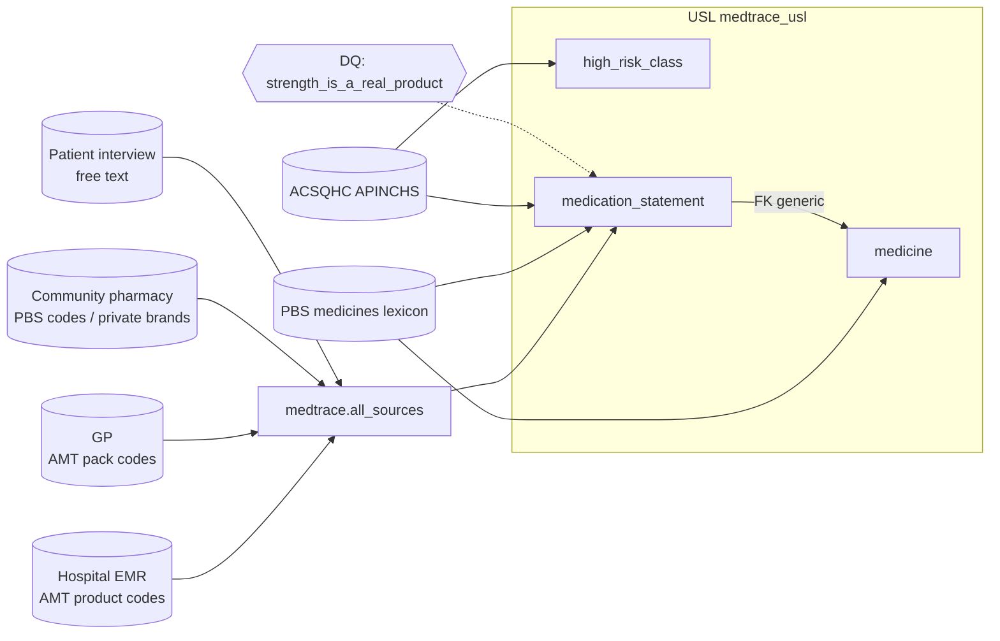

<!-- Generated by scripts/zetaris_docs.py from docs/zetaris_usl/results/*.json. Do not edit by hand: re-run the scripts. -->

# 1c — The Unified Semantic Layer: build, verify, quality state

**`lightning.metastore.medtrace.medtrace_usl`** — one semantic model, three related tables, six registered sources. Created live on Zetaris with the DDL below (`python3 scripts/register_sources.py --usl --apply`; dry run without `--apply`).



Every source codes medicines its own way — the EMR by AMT medicinal product, the GP by AMT *pack*, the pharmacy by PBS item (or, for private scripts, only a brand), the patient in their own words. `medication_statement` resolves all of that **once**, in its activation query; every question after that is a single `SELECT`.

## The DDL

**`data/zetaris/usl/01_usl_namespace_metastore.sql`**

```sql
-- Parent namespace. On a clean instance the child below fails without it
-- ("parent namespace : metastore is not existing"; Zetaris SQL companion 8.4).
CREATE NAMESPACE IF NOT EXISTS lightning.metastore
```

**`data/zetaris/usl/02_usl_namespace_medtrace.sql`**

```sql
-- MedTrace's namespace for its Unified Semantic Layer.
CREATE NAMESPACE IF NOT EXISTS lightning.metastore.medtrace
```

**`data/zetaris/usl/03_usl_compile_medtrace_usl.sql`**

```sql
-- The MedTrace USL: three related tables over six registered sources.
--   high_risk_class       <- APINCHS (ACSQHC high-risk medicine classes)
--   medicine              <- the PBS medicines lexicon, one row per generic
--   medication_statement  <- EMR + GP + pharmacy + patient interview, every line resolved
--                            to a medicine, its ATC and its high-risk class
-- One statement: a multi-table COMPILE must be sent intact, with each CREATE TABLE on
-- its own line (Zetaris command reference 13.1). The semicolons below separate tables;
-- there is none at the end. Columns are scalar (ARRAY/MAP/STRUCT are not supported).
-- The PRIMARY KEYs and the FOREIGN KEY generate Zetaris data-quality rules of their own.
-- The silo column is `source_system`: a column named `source` is rejected as invalid DDL
-- (found live, 27 Oct, with COMPILE USL without DEPLOY).
COMPILE USL medtrace_usl DEPLOY NAMESPACE lightning.metastore.medtrace DDL
CREATE TABLE high_risk_class (
  atc_prefix varchar(16) NOT NULL PRIMARY KEY,
  apinchs_class varchar(64),
  label varchar(200)
);
CREATE TABLE medicine (
  generic varchar(120) NOT NULL PRIMARY KEY,
  atc_primary varchar(16),
  product_count int,
  strengths varchar(1000)
);
CREATE TABLE medication_statement (
  row_id varchar(32) NOT NULL PRIMARY KEY,
  source_system varchar(16),
  patient_id varchar(32),
  record_kind varchar(32),
  doc_date varchar(32),
  med_text varchar(500),
  code_system varchar(16),
  med_code varchar(64),
  generic varchar(120) FOREIGN KEY REFERENCES medicine(generic),
  atc varchar(16),
  high_risk_class varchar(64),
  resolved_by varchar(16),
  strength_text varchar(64),
  dose_text varchar(64),
  freq_text varchar(200),
  status_text varchar(64),
  qty varchar(16),
  days_supply varchar(16),
  pharmacy_id varchar(32),
  script_type varchar(16),
  strength_listed boolean
)
```

**`data/zetaris/usl/04_usl_describe.sql`**

```sql
-- Model description (the same form the Zetaris open-data USL scripts use).
UPDATE USL lightning.metastore.medtrace.medtrace_usl SET DESCRIPTION 'MedTrace medication reconciliation - every medicine line from the hospital EMR, GP, community pharmacy and patient interview, resolved to a PBS medicine, its ATC code and its ACSQHC high-risk class. Synthetic patient data.'
```

**`data/zetaris/usl/05_usl_activate_high_risk_class.sql`**

```sql
-- APINCHS: the ACSQHC high-risk medicine classes, keyed by ATC prefix (42 rows).
ACTIVATE USL TABLE lightning.metastore.medtrace.medtrace_usl.high_risk_class AS
SELECT COALESCE(atc_prefix, '') AS atc_prefix, apinchs_class, label
FROM medtrace.APINCHS
```

**`data/zetaris/usl/06_usl_activate_medicine.sql`**

```sql
-- The PBS lexicon, one row per generic (98), with every real product strength listed.
-- pbs_code cannot be the key: 224 lexicon rows carry 184 distinct codes.
ACTIVATE USL TABLE lightning.metastore.medtrace.medtrace_usl.medicine AS
SELECT COALESCE(generic, '') AS generic,
       MAX(atc_primary) AS atc_primary,
       CAST(COUNT(*) AS INT) AS product_count,
       concat_ws(', ', sort_array(collect_set(strength))) AS strengths
FROM medtrace.MED_LEXICON
GROUP BY generic
```

**`data/zetaris/usl/07_usl_activate_medication_statement.sql`**

```sql
-- Every medicine line from the four silos (13,856), resolved to a medicine.
-- Each source codes medicines its own way, and this is where that is reconciled once:
--   EMR       AMT medicinal product (amt_mp)
--   GP        AMT medicinal product pack (amt_mpp)
--   pharmacy  PBS item code; private scripts carry none and resolve by brand
--   patient   free text only -- left unresolved here (resolved_by = 'none')
-- Each exploded view is referenced ONCE: referencing one twice fails with
-- MISSING_ATTRIBUTES (Zetaris SQL companion section 4), so the lexicon becomes a single
-- key map in one pass, with each generic's real strengths attached by a window function.
-- The longest matching APINCHS ATC prefix wins.
ACTIVATE USL TABLE lightning.metastore.medtrace.medtrace_usl.medication_statement AS
WITH code_map AS (
  SELECT DISTINCT k.lookup, k.key, generic, atc_primary, strengths
  FROM (
    SELECT generic, atc_primary, amt_mp, amt_mpp, pbs_code, brand,
           collect_set(lower(trim(strength))) OVER (PARTITION BY generic) AS strengths
    FROM medtrace.MED_LEXICON
  ) lx
  LATERAL VIEW explode(array(
    named_struct('lookup', 'amt_mp', 'key', amt_mp),
    named_struct('lookup', 'amt_mpp', 'key', amt_mpp),
    named_struct('lookup', 'pbs_code', 'key', pbs_code),
    named_struct('lookup', 'brand', 'key', lower(brand))
  )) t AS k
),
stmt AS (
  SELECT a.*,
    CASE WHEN a.source = 'emr' THEN 'amt_mp'
         WHEN a.source = 'gp' THEN 'amt_mpp'
         WHEN a.source = 'pharmacy' AND a.script_type = 'private' THEN 'brand'
         WHEN a.source = 'pharmacy' THEN 'pbs_code' END AS lookup,
    CASE WHEN a.source = 'pharmacy' AND a.script_type = 'private' THEN lower(a.med_text)
         ELSE a.med_code END AS key
  FROM medtrace.ALL_SOURCES a
),
resolved AS (
  SELECT s.*, m.generic, m.atc_primary AS atc,
         CASE WHEN m.generic IS NULL THEN 'none' ELSE s.lookup END AS resolved_by,
         m.strengths
  FROM stmt s LEFT JOIN code_map m ON s.lookup = m.lookup AND s.key = m.key
),
ranked AS (
  SELECT r.*, h.apinchs_class,
         ROW_NUMBER() OVER (PARTITION BY r.row_id ORDER BY length(h.atc_prefix) DESC) AS rn
  FROM resolved r LEFT JOIN medtrace.APINCHS h ON r.atc LIKE concat(h.atc_prefix, '%')
)
SELECT COALESCE(row_id, '') AS row_id, source AS source_system, source_patient_id AS patient_id, record_kind, doc_date,
       med_text, code_system, med_code, generic, atc, apinchs_class AS high_risk_class, resolved_by,
       strength_text, dose_text, freq_text, status_text, qty, days_supply, pharmacy_id, script_type,
       CASE WHEN generic IS NULL OR strength_text IS NULL OR trim(strength_text) = '' THEN NULL
            ELSE array_contains(strengths, lower(trim(strength_text))) END AS strength_listed
FROM ranked
WHERE rn = 1
```

**`data/zetaris/usl/08_usl_dq_strength_is_a_real_product.sql`**

```sql
-- Data-quality rule (native Zetaris DQ, command reference 14.1): a medicine line that
-- names a medicine and a strength must name a strength that medicine is actually made in.
-- "amlodipine 2.5 mg" fails: amlodipine comes as 5 mg and 10 mg, so 2.5 mg means a halved
-- tablet or a charting error -- either way a dose a pharmacist must confirm.
-- Lines with no resolved medicine or no stated strength (patient free text, devices) pass:
-- this rule judges strengths, not resolution. A same-table boolean expression, the form
-- Zetaris has confirmed (no window functions, no row alias; companion 8.6).
REGISTER DQ strength_is_a_real_product TABLE lightning.metastore.medtrace.medtrace_usl.medication_statement AS
COALESCE(strength_listed, true)
```

## The USL is active

### The USL's tables and activation state.

```sql
SHOW NAMESPACES OR TABLES IN lightning.metastore.medtrace
```

| name | type | usl_id | count | activated |
|---|---|---|---|---|
| medtrace_usl | usl | 1014 | 3 | ∅ |

<sub>1 rows · 245 ms · run 2026-10-27T08:04:20+00:00 UTC via `app/adapters/zetaris.py (read-only)` · [`results/1c_usl_tables.json`](results/1c_usl_tables.json)</sub>

### Is the USL active? Every line from four silos, resolved to a medicine, in one table.

```sql
SELECT source_system, resolved_by, COUNT(*) AS lines, COUNT(generic) AS resolved, COUNT(high_risk_class) AS high_risk_lines FROM lightning.metastore.medtrace.medtrace_usl.medication_statement GROUP BY source_system, resolved_by ORDER BY source_system
```

| source_system | resolved_by | lines | resolved | high_risk_lines |
|---|---|---|---|---|
| emr | amt_mp | 1561 | 1561 | 205 |
| gp | amt_mpp | 1527 | 1527 | 207 |
| patient | none | 1552 | 0 | 0 |
| pharmacy | pbs_code | 8895 | 8895 | 1375 |
| pharmacy | brand | 321 | 321 | 64 |

<sub>5 rows · 19,454 ms · run 2026-10-27T08:03:39+00:00 UTC via `app/adapters/zetaris.py (read-only)` · [`results/1c_usl_1.json`](results/1c_usl_1.json)</sub>

### Which high-risk classes appear in which source? (Without the USL: 4 silos x 3 coding systems + lexicon + APINCHS.)

```sql
SELECT high_risk_class, source_system, COUNT(*) AS lines, COUNT(DISTINCT patient_id) AS patients FROM lightning.metastore.medtrace.medtrace_usl.medication_statement WHERE high_risk_class IS NOT NULL GROUP BY high_risk_class, source_system ORDER BY high_risk_class, source_system
```

| high_risk_class | source_system | lines | patients |
|---|---|---|---|
| C | emr | 1 | 1 |
| C | gp | 1 | 1 |
| C | pharmacy | 20 | 2 |
| Ext | emr | 44 | 38 |
| Ext | gp | 40 | 39 |
| Ext | pharmacy | 129 | 41 |
| H | emr | 48 | 43 |
| H | gp | 46 | 46 |
| H | pharmacy | 247 | 49 |
| I | emr | 44 | 39 |

<sub>15 rows (first 10 shown) · 20,277 ms · run 2026-10-27T08:04:00+00:00 UTC via `app/adapters/zetaris.py (read-only)` · [`results/1c_usl_2.json`](results/1c_usl_2.json)</sub>

### For each strength that is not a real product, what strengths does the medicine come in?

```sql
SELECT s.row_id, s.patient_id, s.generic, s.strength_text AS charted, m.strengths AS made_in FROM lightning.metastore.medtrace.medtrace_usl.medication_statement s JOIN lightning.metastore.medtrace.medtrace_usl.medicine m ON s.generic = m.generic WHERE s.strength_listed = false ORDER BY s.row_id
```

| row_id | patient_id | generic | charted | made_in |
|---|---|---|---|---|
| EMR-000015 | MRN0000002 | aspirin | 50 mg | 100 mg |
| EMR-000320 | MRN0000038 | telmisartan | 20 mg | 40 mg, 80 mg |
| EMR-000361 | MRN0000043 | rosuvastatin | 2.5 mg | 10 mg, 20 mg, 40 mg, 5 mg |
| EMR-000459 | MRN0000057 | amlodipine | 2.5 mg | 10 mg, 5 mg |
| EMR-000697 | MRN0000085 | amlodipine | 2.5 mg | 10 mg, 5 mg |
| EMR-000710 | MRN0000086 | ezetimibe | 5 mg | 10 mg |
| EMR-000743 | MRN0000091 | glyceryl trinitrate | 0.2 mg | 400 microgram/dose |
| EMR-000752 | MRN0000092 | mirabegron | 12.5 mg | 25 mg, 50 mg |
| EMR-000765 | MRN0000095 | irbesartan/hydrochlorothiazide | 150 mg | 150/12.5 mg, 300/12.5 mg |
| EMR-000855 | MRN0000108 | paracetamol | 332.5 mg | 500 mg, 665 mg |

<sub>14 rows (first 10 shown) · 18,742 ms · run 2026-10-27T08:04:20+00:00 UTC via `app/adapters/zetaris.py (read-only)` · [`results/1c_usl_3.json`](results/1c_usl_3.json)</sub>

## Data quality: native Zetaris rules

**Custom rule `strength_is_a_real_product` executed: 14 of 13856 records invalid (13842 valid).** A line naming a medicine and a strength must name a strength that medicine is made in — `amlodipine 2.5 mg` fails because amlodipine comes as 5 mg and 10 mg.

**Checked against the answer key:** 14 of the 14 violations are planted chart-dose errors. The rule catches 14 of the 28 planted dose errors; the rest chart a strength that *is* a real product (20 mg where 10 mg is right), which only a cross-source comparison can see — that is MedTrace's detector's job, not a single-table rule's.

**The foreign-key rule (`generic` → `medicine`) reports 1552 invalid records** — exactly the patient-interview lines, which carry no code and so no resolved medicine. Zetaris counts a NULL foreign key as invalid. That is a true statement about the data: those lines can only be matched downstream (MedTrace does it with the lexicon and a constrained model choice), not by code.

### Which data-quality rules does the USL carry?

```sql
LIST DQ USL lightning.metastore.medtrace.medtrace_usl
```

| name | table | type | expression |
|---|---|---|---|
| atc_prefix | high_risk_class | Primary key constraints |  |
| generic | medicine | Primary key constraints |  |
| row_id | medication_statement | Primary key constraints |  |
| generic | medication_statement | Foreign key constraints |  |
| strength_is_a_real_product | medication_statement | Custom Data Quality | COALESCE(strength_listed, true) |

<sub>5 rows · 165 ms · run 2026-10-27T08:04:20+00:00 UTC via `scripts/register_sources.py (build-time)` · [`results/1c_dq_list.json`](results/1c_dq_list.json)</sub>

### Run the custom rule: is every charted strength a real product?

```sql
RUN DQ strength_is_a_real_product TABLE lightning.metastore.medtrace.medtrace_usl.medication_statement
```

| name | table | type | total_record | valid_record | invalid_record |
|---|---|---|---|---|---|
| strength_is_a_real_product | medication_statement | Custom Data Quality | 13856 | 13842 | 14 |

<sub>1 rows · 38,536 ms · run 2026-10-27T08:04:59+00:00 UTC via `scripts/register_sources.py (build-time)` · [`results/1c_dq_run.json`](results/1c_dq_run.json)</sub>

### Run the foreign-key rule: does every resolved generic exist in medicine?

```sql
RUN DQ generic TABLE lightning.metastore.medtrace.medtrace_usl.medication_statement
```

| name | table | type | total_record | valid_record | invalid_record |
|---|---|---|---|---|---|
| generic | medication_statement | Foreign Key Constraint | 13856 | 12304 | 1552 |

<sub>1 rows · 36,108 ms · run 2026-10-27T08:05:56+00:00 UTC via `scripts/register_sources.py (build-time)` · [`results/1c_dq_fk.json`](results/1c_dq_fk.json)</sub>

### Which records fail it?

```sql
SHOW DQ INVALID RECORD strength_is_a_real_product TABLE lightning.metastore.medtrace.medtrace_usl.medication_statement
```

| row_id | patient_id | record_kind | generic | strength_text | freq_text |
|---|---|---|---|---|---|
| EMR-000015 | MRN0000002 | admission_chart | aspirin | 50 mg | 1 daily |
| EMR-000320 | MRN0000038 | admission_chart | telmisartan | 20 mg | 1 daily |
| EMR-000361 | MRN0000043 | admission_chart | rosuvastatin | 2.5 mg | 1 daily |
| EMR-000459 | MRN0000057 | admission_chart | amlodipine | 2.5 mg | 1 daily |
| EMR-000697 | MRN0000085 | admission_chart | amlodipine | 2.5 mg | 1 daily |
| EMR-000710 | MRN0000086 | admission_chart | ezetimibe | 5 mg | 1 daily |
| EMR-000743 | MRN0000091 | admission_chart | glyceryl trinitrate | 0.2 mg | prn |
| EMR-000752 | MRN0000092 | admission_chart | mirabegron | 12.5 mg | 1 daily |
| EMR-000765 | MRN0000095 | admission_chart | irbesartan/hydrochlorothiazide | 150 mg | 1 daily |
| EMR-000855 | MRN0000108 | admission_chart | paracetamol | 332.5 mg | 2 tds |

<sub>14 rows (first 10 shown) · 18,204 ms · run 2026-10-27T08:05:19+00:00 UTC via `scripts/register_sources.py (build-time)` · [`results/1c_dq_invalid.json`](results/1c_dq_invalid.json)</sub>

